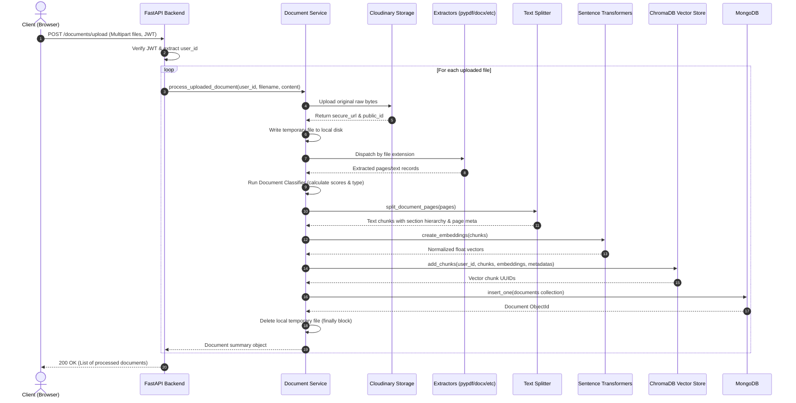
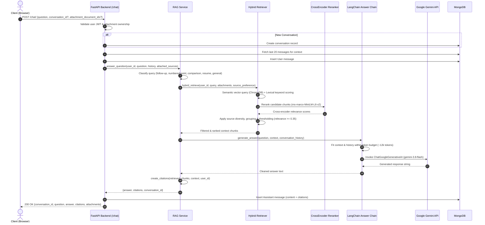
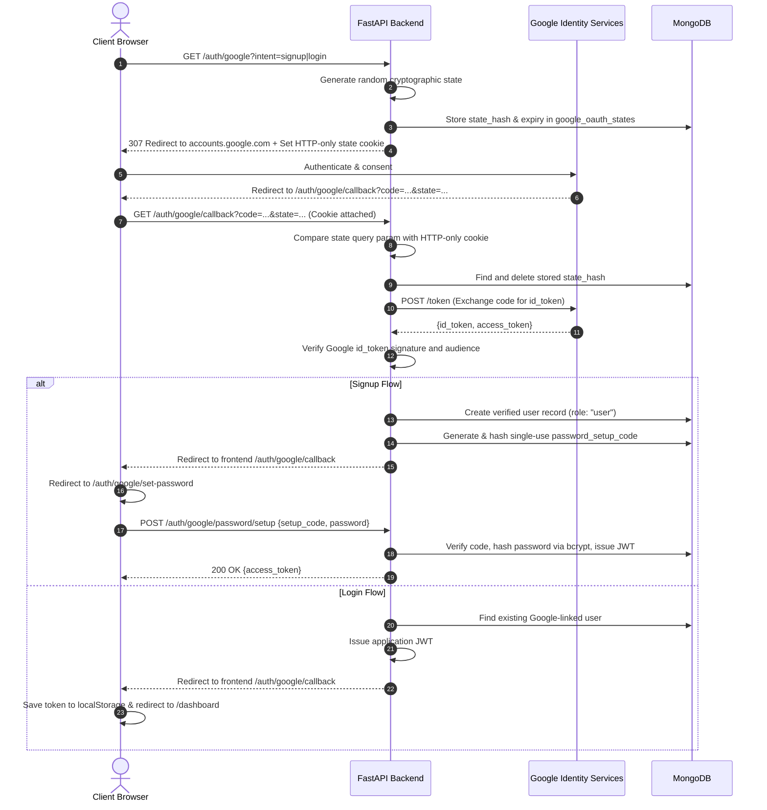

# Multi-Document Research Assistant (ResearchAI)

An enterprise-grade, full-stack AI research platform engineered for ingesting, indexing, semantically retrieving, and synthesizing insights across heterogeneous document collections and web sources with strict evidence grounding and citation traceability.

---

## Table of Contents

1. [Executive Overview & Problem Statement](#1-executive-overview--problem-statement)
2. [System Architecture & Data Flow](#2-system-architecture--data-flow)
   - 2.1 [High-Level Architecture](#21-high-level-architecture)
   - 2.2 [Document Ingestion Sequence](#22-document-ingestion-sequence)
   - 2.3 [RAG Question-Answering Sequence](#23-rag-question-answering-sequence)
   - 2.4 [Google OAuth 2.0 Sequence](#24-google-oauth-20-sequence)
3. [Technology Stack & Dependency Matrix](#3-technology-stack--dependency-matrix)
4. [Repository & Directory Structure](#4-repository--directory-structure)
5. [Document Management & Ingestion Pipeline](#5-document-management--ingestion-pipeline)
   - 5.1 [Supported File Types & Extraction Engines](#51-supported-file-types--extraction-engines)
   - 5.2 [Automated Document Classification Engine](#52-automated-document-classification-engine)
   - 5.3 [Structure-Aware Text Splitting & Hierarchy Tracking](#53-structure-aware-text-splitting--hierarchy-tracking)
   - 5.4 [Web Page Ingestion & DuckDuckGo Search](#54-web-page-ingestion--duckduckgo-search)
   - 5.5 [Storage Lifecycle & Atomic Cleanup](#55-storage-lifecycle--atomic-cleanup)
6. [AI, Retrieval-Augmented Generation (RAG) & LangChain Pipeline](#6-ai-retrieval-augmented-generation-rag--langchain-pipeline)
   - 6.1 [Vector Embeddings & ChromaDB Storage](#61-vector-embeddings--chromadb-storage)
   - 6.2 [Hybrid Retrieval Algorithm & Cross-Encoder Reranking](#62-hybrid-retrieval-algorithm--cross-encoder-reranking)
   - 6.3 [Domain-Specific Query Handlers](#63-domain-specific-query-handlers)
   - 6.4 [Generation Prompt Engineering & Context Budgeting](#64-generation-prompt-engineering--context-budgeting)
   - 6.5 [LLM Factory, Error Classification & Provider Handling](#65-llm-factory-error-classification--provider-handling)
   - 6.6 [Citation Assembly & Deduplication](#66-citation-assembly--deduplication)
7. [Authentication, Authorization & Account Security](#7-authentication-authorization--account-security)
   - 7.1 [Email & Password Registration with SMTP OTP](#71-email--password-registration-with-smtp-otp)
   - 7.2 [Google OAuth 2.0 Authorization Code Flow](#72-google-oauth-20-authorization-code-flow)
   - 7.3 [Password Setup & Password Reset Workflows](#73-password-setup--password-reset-workflows)
   - 7.4 [Role-Based Access Control (RBAC) & Administrative Guard](#74-role-based-access-control-rbac--administrative-guard)
8. [Frontend Application Architecture & User Experience](#8-frontend-application-architecture--user-experience)
   - 8.1 [Next.js App Router Structure](#81-nextjs-app-router-structure)
   - 8.2 [Component Library & Design System](#82-component-library--design-system)
   - 8.3 [Client State Management & Session Lifecycle](#83-client-state-management--session-lifecycle)
   - 8.4 [Page Breakdown & Core Interactions](#84-page-breakdown--core-interactions)
9. [Feedback & Notification Module](#9-feedback--notification-module)
10. [Database Architecture & Storage Schemas](#10-database-architecture--storage-schemas)
    - 10.1 [MongoDB Collections & Indexes](#101-mongodb-collections--indexes)
    - 10.2 [ChromaDB Vector Metadata Schema](#102-chromadb-vector-metadata-schema)
    - 10.3 [Cloudinary Asset Schema](#103-cloudinary-asset-schema)
11. [Complete REST API Specification](#11-complete-rest-api-specification)
12. [Environment Configuration Reference](#12-environment-configuration-reference)
13. [Installation, Setup & Local Execution Guide](#13-installation-setup--local-execution-guide)
14. [Testing, Linting & Code Verification](#14-testing-linting--code-verification)
15. [Incomplete Features, Technical Debt & Known Issues](#15-incomplete-features-technical-debt--known-issues)
16. [Security Considerations & Hardening](#16-security-considerations--hardening)
17. [Production Deployment & Operational Topology](#17-production-deployment--operational-topology)
18. [Future Roadmap](#18-future-roadmap)

---

## 1. Executive Overview & Problem Statement

### 1.1 Overview
The **Multi-Document Research Assistant** (branded in the user interface as **ResearchAI**) is a modern web platform designed to eliminate information silos across heterogeneous document formats and digital publications. The system empowers researchers, analysts, students, and professionals to assemble personal libraries comprising local files (PDFs, Microsoft Office documents, spreadsheets, presentations, and plain text) alongside live web articles.

Users can interrogate their aggregated corpus using natural language, engage in multi-turn dialogues with conversational memory, isolate specific files as query attachments, explore cross-document comparisons, and inspect verifiable, page- and section-specific citations attached to every generated response.

### 1.2 Problem Statement
Knowledge workers spend an estimated 20% to 30% of their working hours searching for, cross-referencing, and synthesizing information scattered across disparate formats:
1. **Format Fragmentation:** Critical data is trapped in disconnected formats—research papers in PDF, briefs in Word (`.docx`), project plans in presentations (`.pptx`), tabular metrics in Excel (`.xlsx`/`.csv`), and web references in HTML.
2. **Lexical Search Shortcomings:** Standard keyword search fails when queries use synonyms or conceptual descriptions rather than literal substrings.
3. **LLM Hallucination & Lack of Verifiability:** Off-the-shelf generative AI models invent citations, misattribute facts across sources, and hallucinate details when context is ambiguous.
4. **Context Loss Across Multi-Turn Dialogue:** Users frequently ask relative follow-up queries (e.g., *"Elaborate on point 3"* or *"What was the methodology mentioned earlier?"*) which standard single-shot search engines cannot resolve.
5. **Security & Data Isolation:** Multi-user environments require strict tenant boundaries so that no user's documents or vector embeddings leak into another user's search space.

### 1.3 Key Architectural Differentiators
- **Tenant-Isolated Hybrid Retrieval:** Combines dense cosine semantic search with BM25-style lexical keyword frequency and cross-encoder deep neural reranking, all strictly scoped by `user_id`.
- **Structural Heading & Hierarchy Awareness:** Document text is not split blindly; numbered section headers (e.g., `1.1`, `2.3.4`) and parent-child hierarchies are parsed and attached to vector chunks to preserve context.
- **Automated Document Categorization:** Uploaded documents are automatically classified into categories (e.g., `resume`, `research_paper`, `assignment`, `report`, `spreadsheet`) during ingestion to facilitate category-filtered queries.
- **Strict Grounding & Disjoint Comparison Enforcement:** System prompts explicitly prohibit cross-document fact contamination during comparative queries (e.g., candidate resume comparisons).
- **Dual-Storage Strategy:** Metadata and relational references reside in MongoDB, vector embeddings reside in ChromaDB, and original uploaded files reside securely in Cloudinary.

---

## 2. System Architecture & Data Flow

### 2.1 High-Level Architecture

```
                                  +---------------------------------------+
                                  |            CLIENT BROWSER             |
                                  |  Next.js 16 (App Router) + React 19   |
                                  |  Tailwind CSS 4 + Lucide React Icons  |
                                  +---------------------------------------+
                                                     |
                                                     | HTTP / HTTPS Requests
                                                     | JSON Payload / Multipart Form-Data
                                                     | Bearer JWT Authentication
                                                     v
+--------------------------------------------------------------------------------------------------+
|                                    FASTAPI BACKEND APPLICATION                                    |
|                                                                                                  |
|  +--------------------+  +----------------------+  +---------------------+  +-----------------+  |
|  |   Auth Middleware  |  |  CORS & Environment  |  |   Pydantic V2 Schemas|  | Logging & Timing |  |
|  | (JWT, RBAC, Admin) |  |   (Origin Aliasing)  |  |   (Data Validation) |  |   Middleware    |  |
|  +--------------------+  +----------------------+  +---------------------+  +-----------------+  |
|                                                                                                  |
|  +--------------------------------------------------------------------------------------------+  |
|  |                                      ROUTER MODULES                                        |  |
|  |  /auth  |  /users  |  /documents  |  /urls  |  /chat  |  /history  |  /admin  |  /feedback   |  |
|  +--------------------------------------------------------------------------------------------+  |
|           |                       |                   |                   |                      |
|           v                       v                   v                   v                      |
|  +-----------------+    +-------------------+   +-------------+   +-------------------+          |
|  |  Auth Services  |    | Document Pipeline |   | URL Service |   |    RAG Engine     |          |
|  |  - Passlib/Hash |    | - Extractors      |   | - Requests  |   | - Query Analyzer  |          |
|  |  - SMTP Client  |    | - Classifier      |   | - BS4 Parse |   | - Hybrid Search   |          |
|  |  - Google OAuth |    | - Hierarchical    |   | - Splitter  |   | - Cross-Encoder   |          |
|  +-----------------+    |   Splitter        |   +-------------+   | - LangChain Chain |          |
|                         +-------------------+                     +-------------------+          |
+--------------------------------------------------------------------------------------------------+
            |                               |                               |
            v                               v                               v
+-----------------------+       +-----------------------+       +-----------------------+
|        MONGODB        |       |       CHROMADB        |       |   GOOGLE GEMINI API   |
|   Persistent Storage  |       |   Local Vector Store  |       |      (LLM Provider)   |
|-----------------------|       |-----------------------|       |-----------------------|
| - Users & Credentials |       | - Collection:         |       | - gemini-3.8-flash    |
| - OTP Verification    |       |   research_chunks     |       | - Temperature: 0.2    |
| - Document Metadata   |       | - Cosine Distance     |       | - Non-streaming       |
| - Chat Conversations  |       | - Chunk Text          |       | - Strict Grounding    |
| - Message History     |       | - Normalized Vectors  |       +-----------------------+
| - Feedback & Admin    |       | - Hierarchical Meta   |                   |
+-----------------------+       +-----------------------+                   |
            |                               |                               |
            v                               +---------------+---------------+
+-----------------------+                                   |
|      CLOUDINARY       |                                   v
|   Cloud File Store    |                       +-----------------------+
|-----------------------|                       | SENTENCE TRANSFORMERS |
| - Raw File Assets     |                       | - Embedding Model     |
| - Signed Open Redirect|                       | - MS-MARCO Reranker   |
+-----------------------+                       +-----------------------+
```

---

### 2.2 Document Ingestion Sequence



---

### 2.3 RAG Question-Answering Sequence



---

### 2.4 Google OAuth 2.0 Sequence



---

## 3. Technology Stack & Dependency Matrix

### 3.1 Backend Application Stack

| Component / Layer | Technology | Version in Source | Role & Usage |
|---|---|---|---|
| **Programming Language** | Python | `3.12.10` | Core runtime environment |
| **Web Framework** | FastAPI | `0.141.1` | High-performance asynchronous REST API routing and OpenAPI generation |
| **ASGI Web Server** | Uvicorn | `0.53.0` | Production ASGI web server runner |
| **Data Validation** | Pydantic / Pydantic Settings | `2.13.5` / `2.15.0` | Request validation, model enforcement, and schema serialization |
| **Primary Database Driver** | PyMongo | `4.18.1` | Asynchronous/synchronous interface to MongoDB cluster |
| **Vector Database** | ChromaDB | `1.5.9` | Embedded persistent vector storage using HNSW cosine index |
| **LLM Orchestration** | LangChain Core | `1.6.3` / `1.4.2` | Prompt templates, runnable sequences, and string output parsers |
| **LLM Provider Adapter** | `langchain-google-genai` | `4.0.0` | Google Gemini API client integration (`ChatGoogleGenerativeAI`) |
| **Dense Embeddings** | `sentence-transformers` | `6.1.0` | Local neural embedding generation for query and document chunks |
| **Cross-Encoder Reranking**| `sentence-transformers` | `6.1.0` | Deep neural cross-attention score evaluation (`ms-marco-MiniLM-L6-v2`) |
| **Deep Learning Framework**| PyTorch (`torch`) | `2.14.0` | Neural tensor computing backend for Sentence Transformers |
| **PDF Extraction** | `pypdf` | `6.19.0` | Text extraction from PDF documents page by page |
| **Word Processing** | `python-docx` | `1.2.0` | Extraction of paragraphs and structure from `.docx` files |
| **Spreadsheet Processing**| `pandas` / `openpyxl` | `3.0.6` / `3.1.5` | Parsing CSV and multi-sheet Excel workbooks into structured tables |
| **Presentation Processing**| `python-pptx` | `1.0.2` | Extraction of slide text and shapes from PowerPoint presentations |
| **Cloud Object Storage** | `cloudinary` | `1.46.2` | Cloud storage for original uploaded raw files |
| **HTML Parsing & Scraping**| `requests` / `beautifulsoup4` | `2.x` / `4.15.0` | Fetching web pages and stripping boilerplate HTML elements |
| **External Web Search** | `ddgs` (DuckDuckGo Search)| `9.16.0` | Public web search queries returning top title, URL, and snippets |
| **Authentication & Tokens**| `PyJWT` | `2.14.0` | Cryptographic JWT creation and token verification |
| **Password Hashing** | `passlib` / `bcrypt` | `1.7.4` / `4.0.1` | Salted bcrypt password hashing and verification |
| **OAuth Identity** | `google-auth` | `2.61.0` | Google ID token verification and audience validation |
| **Email Dispatch** | Standard Library (`smtplib`) | Built-in | TLS/SSL delivery of registration and password setup OTPs |

### 3.2 Frontend Application Stack

| Component / Layer | Technology | Version in Source | Role & Usage |
|---|---|---|---|
| **Framework** | Next.js (App Router) | `16.3.5` | React framework with server/client component rendering |
| **UI Library** | React / React DOM | `19.2.8` | Component model, hooks, and virtual DOM rendering |
| **Styling Framework** | Tailwind CSS | `4.x` (`@tailwindcss/postcss`) | Utility-first CSS engine with modern CSS variables |
| **Iconography** | Lucide React | `^1.52.0` | Lightweight SVG icons across application interfaces |
| **Code Linting** | ESLint / Next ESLint Config | `^9` / `16.3.5` | Code quality, hook rules, and static analysis |
| **Typography** | Geist Font (`next/font`) | Next.js Built-in | Optimized typography for clean visual rendering |

---

## 4. Repository & Directory Structure

```text
Multi-Document-Research-Assistant-New/
├── .gitignore                          # Root Git ignore rules (venv, .env, chroma_data, uploads)
├── PROJECT_DOCUMENTATION.md            # Supplementary technical reference
├── README.md                           # Comprehensive documentation (this document)
├── backend/
│   ├── .env.example                    # Placeholder example for environment configuration
│   ├── requirements.txt                # Pinned Python package dependencies
│   ├── tests/                          # Automated unittest test suites
│   │   ├── test_feedback.py            # Feedback submission & admin endpoint tests
│   │   ├── test_gemini_llm.py          # Gemini factory & provider error classification tests
│   │   ├── test_google_oauth.py        # OAuth state, code exchange & identity token tests
│   │   ├── test_password_setup.py      # Password setup, reset & bcrypt validation tests
│   │   └── test_rag_context.py         # Retrieval, reranking, source diversity & citation tests
│   └── app/
│       ├── main.py                     # FastAPI entrypoint, CORS configuration, router registration
│       ├── auth/                       # Security & identity verification modules
│       │   ├── google_oauth.py         # Google OAuth 2.0 authorization code flow & token validation
│       │   ├── jwt.py                  # JWT encoding, decoding, get_current_user & get_current_admin
│       │   ├── otp.py                  # 6-digit OTP generation, SHA-256 hashing & TTL expiration
│       │   └── password.py             # Passlib bcrypt password hashing & verification
│       ├── core/                       # Core configuration helpers
│       ├── database/
│       │   └── mongodb.py              # PyMongo client, collection handles, and index initialization
│       ├── documents/                  # Ingestion, parsing, and document lifecycle
│       │   ├── document_service.py     # End-to-end upload orchestration & document classification
│       │   ├── extractor.py            # Format-specific extractors (PDF, DOCX, TXT, CSV, XLSX, PPTX)
│       │   ├── loader.py               # Extractor dispatch based on file extension
│       │   └── splitter.py             # Hierarchical RecursiveCharacterTextSplitter with section logic
│       ├── embeddings/
│       │   └── embedding_model.py      # Cached Sentence Transformers embedding model loader
│       ├── llm/
│       │   └── llm_model.py            # LangChain ChatGoogleGenerativeAI factory & error handler
│       ├── models/                     # Lightweight Python dataclass domain models
│       │   ├── document.py             # Document dataclass
│       │   ├── history.py              # Conversation & Message dataclasses
│       │   ├── otp.py                  # OTP dataclass
│       │   ├── url.py                  # URL dataclass (Note: 0-byte file in current repository)
│       │   └── user.py                 # User dataclass
│       ├── rag/                        # Retrieval-Augmented Generation subsystem
│       │   ├── chain.py                # LangChain prompt templates, token fitting, generation chain
│       │   ├── rag_service.py          # Conversational query analyzer, citation builder, RAG facade
│       │   ├── retriever.py            # Hybrid search, BM25 scoring, CrossEncoder reranking, diversity
│       │   └── vector_store.py         # Persistent ChromaDB client, collection, and search wrapper
│       ├── routes/                     # FastAPI route handlers
│       │   ├── admin.py                # Admin overview, user management, and document oversight
│       │   ├── auth.py                 # Public auth endpoints (register, login, OTP, Google OAuth)
│       │   ├── chat.py                 # Interactive research chat & multi-turn interaction
│       │   ├── documents.py            # File upload, source listing, view redirect, and deletion
│       │   ├── feedback.py             # User feedback submission & admin feedback management
│       │   ├── history.py              # Conversation and chat history retrieval
│       │   ├── urls.py                 # URL source addition, listing, and DuckDuckGo search
│       │   └── users.py                # Current user profile endpoint (/users/me)
│       ├── schemas/                    # Pydantic request/response data contracts
│       │   ├── admin.py                # Admin overview schemas
│       │   ├── auth.py                 # Register, login, OTP, and password schemas
│       │   ├── chat.py                 # ChatRequest schema
│       │   ├── document.py             # Document response schemas
│       │   ├── feedback.py             # Feedback request & response schemas
│       │   ├── history.py              # History conversation & message schemas
│       │   ├── url.py                  # URL addition & search schemas
│       │   └── user.py                 # User profile schemas
│       ├── services/                   # Business logic services
│       │   ├── email_service.py        # SMTP email client for sending verification OTPs
│       │   └── user_service.py         # User creation, authentication, verification, and blocking
│       └── urls/                       # Web ingestion modules
│           ├── extractor.py            # HTML text and title extraction
│           ├── loader.py               # URL loader interface
│           └── url_service.py          # Web scraping, decomposition, and vector ingestion
└── frontend/
    ├── package.json                    # NPM dependencies, scripts (dev, build, start, lint)
    ├── package-lock.json               # Locked dependency tree
    ├── README.md                       # Frontend-specific getting started guide
    └── src/
        ├── app/                        # Next.js App Router pages and style assets
        │   ├── layout.js               # Root layout wrapper
        │   ├── page.js                 # Public landing page
        │   ├── globals.css             # Global Tailwind and font styles
        │   ├── admin/                  # Administrative route group
        │   │   ├── layout.js           # Admin shell wrapper
        │   │   ├── page.js             # Admin overview dashboard
        │   │   ├── documents/page.js   # Admin document inventory
        │   │   ├── feedback/page.js    # Admin feedback inbox & reader
        │   │   ├── urls/page.js        # Admin URL inventory
        │   │   └── users/              # User management views
        │   │       ├── page.js         # User listing table
        │   │       └── [userId]/page.js# User detail, block/unblock view
        │   ├── auth/google/            # Google OAuth frontend handlers
        │   │   ├── callback/page.js    # Fragment parser & redirect coordinator
        │   │   └── set-password/page.js# Post-OAuth password setup form
        │   ├── chat/page.js            # Main interactive research chat workspace
        │   ├── dashboard/page.js       # User personal overview, stats, recent sources
        │   ├── documents/page.js       # Sources manager (upload, URL modal, filter, delete)
        │   ├── forgot-password/page.js # Password reset request and confirmation form
        │   ├── history/page.js         # Chat history viewer and conversation restorer
        │   ├── login/page.js           # User login with password or Google OAuth
        │   ├── register/               # User registration workflow
        │   │   ├── page.js             # Registration form
        │   │   └── verify/page.js      # 6-digit OTP verification screen
        │   └── styles/                 # Modular CSS stylesheets (dashboard, chat, admin, etc.)
        ├── components/                 # Reusable client components
        │   ├── Button.js               # Common button element
        │   ├── ChatMessage.js          # Chat bubble (User vs Assistant)
        │   ├── CitationCard.js         # Expandable citation badge with page/section info
        │   ├── DocumentCard.js         # Document list item with actions (open, delete)
        │   ├── FeedbackDialog.js       # User feedback modal dialog
        │   ├── GoogleAuthButton.js     # Branded Google sign-in/up action button
        │   ├── LoadingSpinner.js       # Reusable loading animation
        │   ├── Navbar.js               # Navigation header component
        │   ├── Sidebar.js              # Collapsible application navigation bar & mobile drawer
        │   ├── UploadBox.js            # Drag-and-drop file upload target with validation
        │   └── admin/                  # Admin-specific components
        │       ├── AdminShell.js       # Admin layout with access gate & notifications
        │       └── AdminUI.js          # Reusable admin UI primitives (headers, status, empty)
        └── lib/                        # Client-side utility libraries
            ├── api.js                  # Centralized fetch wrapper (token injection, error format)
            ├── auth.js                 # Token storage helpers (localStorage wrapper)
            └── citations.js            # Citation deduplication, grouping & relevance filters
```

---

## 5. Document Management & Ingestion Pipeline

### 5.1 Supported File Types & Extraction Engines
The ingestion pipeline dispatches incoming files to specialized parsers based on the file extension. Text extraction is strictly digital (OCR is not implemented; scanned images without text streams will yield empty extractions):

```
+-----------+----------------------+----------------------------------------------------------+
| Extension | Parser Engine        | Extraction Strategy & Structural Preservation            |
+-----------+----------------------+----------------------------------------------------------+
| .pdf      | pypdf.PdfReader      | Iterates page-by-page; preserves 1-based page numbers.   |
| .docx     | python-docx          | Iterates document paragraphs; joins non-empty text.      |
| .txt      | Python built-in      | Decodes UTF-8 with errors="ignore" fallback.             |
| .csv      | pandas.read_csv      | Converts tabular data into aligned whitespace table.     |
| .xlsx     | pandas.read_excel    | Extracts all sheets; prefixes text with "Sheet: {name}". |
| .pptx     | python-pptx          | Iterates slides & shapes; tracks 1-based slide numbers.  |
+-----------+----------------------+----------------------------------------------------------+
```

### 5.2 Automated Document Classification Engine
During ingestion, `backend/app/documents/document_service.py` evaluates up to 20,000 characters of extracted text alongside the normalized filename to automatically classify the document into one of eight categories:
1. `resume` (Detects contact info, education, work experience, technical skills, certifications)
2. `research_paper` (Detects abstract, methodology, literature review, references, DOI, results)
3. `assignment` (Detects assignment, submitted by/to, roll/register number, course, question/answer)
4. `report` (Detects executive summary, findings, recommendations)
5. `presentation` (Assigned for `.pptx` files or slide-heavy structures)
6. `spreadsheet` (Assigned for `.csv` and `.xlsx` files)
7. `text_document` (Default for general `.txt` and `.docx` documents)
8. `other` (Fallback when confidence is negligible)

The classification type and confidence score are persisted in both MongoDB and ChromaDB scalar metadata, enabling hard filtering during semantic search.

### 5.3 Structure-Aware Text Splitting & Hierarchy Tracking
Instead of standard arbitrary character splitting, `backend/app/documents/splitter.py` implements a structure-aware splitting algorithm:
- **Base Splitter:** LangChain `RecursiveCharacterTextSplitter` configured with `chunk_size = 1000`, `chunk_overlap = 150`, and hierarchical separators (`["\n\n", "\n", ". ", "? ", "! ", "; ", ", ", " ", ""]`).
- **Heading Detection:** Regex scans for numbered headings matching `^\s*(\d+(?:\.\d+)*)[\.\)]?\s+(.+?)\s*$` (e.g., `1. Introduction`, `2.3 Core Pipeline`).
- **Parent Hierarchy Computation:** Converts sub-section numbers into parent references (e.g., `2.3.1` -> parent `2.3`; `2.3` -> parent `2`).
- **Chunk Metadata Injection:** Every generated chunk retains:
  - `page`: 1-based page or slide index (when available)
  - `section`: Numbered section identifier (e.g., `2.1`)
  - `section_title`: Heading text (e.g., `Models`)
  - `parent_section`: Immediate parent section identifier
  - `hierarchy_level`: Section nesting depth (e.g., `1` for top-level, `2` for sub-sections)

### 5.4 Web Page Ingestion & DuckDuckGo Search
1. **URL Ingestion (`POST /urls/add`):**
   - Fetches target web page via Python `requests` with a 15-second timeout and realistic desktop User-Agent.
   - Parses HTML using BeautifulSoup; aggressively strips non-content tags (`<script>`, `<style>`, `<noscript>`, `<header>`, `<footer>`, `<nav>`, `<form>`, `<svg>`).
   - Targets `<main>` content container if present, falling back to clean body text.
   - Extracts page `<title>` (or domain name if missing).
   - Passes cleaned lines to `split_document_pages()`, generates embeddings, adds to ChromaDB, and stores source metadata in MongoDB under `source_type: "url"`.
2. **Web Search (`GET /urls/search?query=...`):**
   - Invokes DuckDuckGo Search (`ddgs.DDGS().text()`) to query the live web.
   - Returns up to 5 results containing `title`, `href` (URL), and `body` (snippet).
   - Note: Search results are purely informational and are **not** automatically indexed until explicitly submitted to `/urls/add`.

### 5.5 Storage Lifecycle & Atomic Cleanup
- **Cloud Storage:** Uploaded files are streamed to Cloudinary as raw assets. The Cloudinary public ID and secure URL are recorded in MongoDB.
- **Viewing Files:** File viewing requests (`GET /documents/view/{document_id}`) are authenticated, validated against user ownership, and redirected via HTTP 307 to the Cloudinary URL.
- **Atomic Rollback:** If vector store insertion or database persistence fails during upload, the backend triggers an automatic compensation transaction that deletes the uploaded Cloudinary asset and purges any partial chunks from ChromaDB.
- **Cascade Deletion:** Deleting a document (`DELETE /documents/{document_id}`) cascades across all three storage layers: removes records from ChromaDB, deletes the remote file on Cloudinary, and deletes the document record from MongoDB.

---

## 6. AI, Retrieval-Augmented Generation (RAG) & LangChain Pipeline

### 6.1 Vector Embeddings & ChromaDB Storage
- **Embedding Generation:** Handled by `backend/app/embeddings/embedding_model.py` using a Sentence Transformers model loaded via `EMBEDDING_MODEL` environment variable (e.g., `all-MiniLM-L6-v2`).
- **Normalization:** Embeddings are normalized to unit length (`normalize_embeddings=True`), ensuring cosine similarity matches dot product calculations.
- **Vector Database:** An embedded ChromaDB client (`chromadb.PersistentClient`) writes to local disk at `CHROMA_PATH` (default: `./chroma_data`).
- **Collection Configuration:** Uses collection `research_chunks` configured with `hnsw:space: cosine`.
- **Tenant Isolation:** Every chunk stored in ChromaDB includes scalar metadata: `{"user_id": user_id, "source_id": source_id, "filename": filename, ...}`. All retrieval queries enforce strict `{"user_id": user_id}` filtering.

### 6.2 Hybrid Retrieval Algorithm & Cross-Encoder Reranking
Retrieval in `backend/app/rag/retriever.py` follows a multi-stage hybrid ranking strategy:

```
                          User Question + History Context
                                        │
                                        ▼
                  ┌───────────────────────────────────────────┐
                  │ 1. Dense Semantic Search (ChromaDB)       │
                  │    - Unit-normalized query embedding      │
                  │    - Filters: user_id + optional filters  │
                  └───────────────────────────────────────────┘
                                        │
                                        ▼
                  ┌───────────────────────────────────────────┐
                  │ 2. Lexical Keyword Scoring (BM25-style)   │
                  │    - Token overlap & frequency analysis   │
                  │    - Title & section header matches       │
                  └───────────────────────────────────────────┘
                                        │
                                        ▼
                  ┌───────────────────────────────────────────┐
                  │ 3. Deep Neural Cross-Encoder Reranking    │
                  │    - Model: ms-marco-MiniLM-L6-v2         │
                  │    - Joint query-document cross-attention │
                  │    - Evaluates full semantic interaction  │
                  └───────────────────────────────────────────┘
                                        │
                                        ▼
                  ┌───────────────────────────────────────────┐
                  │ 4. Diversity Balancing & Source Grouping  │
                  │    - Prevents single document dominance   │
                  │    - Guarantees multi-source representation│
                  │    - Applies relevance cutoff (>= 0.35)   │
                  └───────────────────────────────────────────┘
                                        │
                                        ▼
                              Ranked Context Blocks
```

### 6.3 Domain-Specific Query Handlers
`retriever.py` and `rag_service.py` inspect incoming questions to route them through specialized optimization paths:
- **Resume Queries:** Detects queries about resumes or candidates (e.g., *"Compare these candidates"* or *"Who knows Python?"*). Filters candidates using the `document_type: "resume"` metadata and strips irrelevant boilerplate.
- **Comparative Queries:** Identifies comparison keywords (`compare`, `difference`, `versus`, `both`, `shared`). Collects semantic leaders separately from each compared source to ensure balanced representation.
- **Section Queries:** Detects requests for specific chapters or sections (e.g., *"Summarize section 2.3"*). Expands matching parent and child sections for complete context.
- **Definition Queries:** Identifies definitional queries (e.g., *"What is X?"* or *"Define Y"*). Boosts passages containing definitive predicates (`is`, `means`, `refers to`, `consists of`).
- **All-Sources Discovery:** When a user asks *"List all my files"* or *"What documents do I have?"*, the retriever bypasses chunk similarity and returns an overview of the user's document catalog.

### 6.4 Generation Prompt Engineering & Context Budgeting
- **Strict Grounding Directive:** The prompt template in `backend/app/rag/chain.py` explicitly commands the LLM to base all factual statements solely on the provided evidence blocks. When information is absent, it must explicitly state that the sources do not provide sufficient information.
- **Disjoint Comparison Rule:** When comparing multiple documents, the prompt strictly enforces that a fact or skill must **never** be attributed to Document B simply because it appeared in Document A.
- **Request Token Budgeting:** To prevent model context exhaustion and rate-limit spikes:
  - Estimated request budget: **12,000 tokens**
  - Conversation history cap: **2,500 characters** (using up to the last 20 messages)
  - Dynamic block trimming: If estimated tokens exceed the budget, lower-ranked context blocks are trimmed or omitted.
- **Numbered Point Resolution:** Follow-up queries referencing prior answers (e.g., *"Explain point 2"*) trigger an extraction step that locates "Point 2" in the preceding assistant message and focuses retrieval on that specific topic.
- **General Knowledge Fallback:** If no relevant sources exist and the query is a general knowledge question (e.g., *"What is photosynthesis?"*), the system permits a general answer while explicitly labeling it as ungrounded in the user's documents.

### 6.5 LLM Factory, Error Classification & Provider Handling
- **Provider:** Google Gemini configured via LangChain `ChatGoogleGenerativeAI`.
- **Model Name:** `gemini-3.8-flash`.
- **Inference Parameters:** `temperature=0.2`, `streaming=False`.
- **Error Classifier (`gemini_error_message`):** Automatically maps raw Google/gRPC API exceptions into human-readable diagnostics:
  - `401 / 403`: Authentication failed; invalid `GEMINI_API_KEY`.
  - `429 (quota)`: Project quota exhausted in Google AI Studio.
  - `429 (rate limit)`: RPM/TPM rate limits exceeded.
  - `404`: Model name unavailable or unsupported for this API key.
  - `413 / 400`: Context window exceeded.

### 6.6 Citation Assembly & Deduplication
- Retrieved chunks used in context generation are tagged with `[Source X: Filename, page Y]`.
- `create_citations()` maps chunks back to MongoDB document records to obtain permanent `document_id`, `url`, and `source_type`.
- Chunks from the same document are aggregated: page numbers are grouped (e.g., `pages: [1, 3, 4]`) and sections are combined.
- Only citations with a normalized relevance score $\ge 0.35$ are presented to the user.
- Frontend citation utilities (`frontend/src/lib/citations.js`) deduplicate citations by ID or composite keys and render them as interactive cards displaying relevance percentages and quick-open actions.

---

## 7. Authentication, Authorization & Account Security

### 7.1 Email & Password Registration with SMTP OTP
1. **Registration Request (`POST /auth/register`):** Validates email format, name, and password strength (min 8 characters). Checks that the email is not already registered and verified.
2. **Password Hashing:** Hashes passwords using salted bcrypt via `passlib.context.CryptContext(schemes=["bcrypt"])`.
3. **OTP Generation & Hashing:** Generates a 6-digit random code (`secrets.randbelow(1_000_000)`). Stores a SHA-256 hash of the code in MongoDB with `purpose: "registration"` and an expiration timestamp (default: 10 minutes).
4. **Email Delivery:** Dispatches the plaintext code via Python `smtplib` using configured SMTP credentials (supports port 587 with STARTTLS or port 465 with SSL).
5. **OTP Verification (`POST /auth/verify-otp`):** Compares the SHA-256 hash of the submitted code against the stored active record. On match, sets `is_verified: True` on the user record and marks the OTP as used.

### 7.2 Google OAuth 2.0 Authorization Code Flow
1. **Authorization Request (`GET /auth/google?intent=signup|login`):** Generates a cryptographic state string, stores its SHA-256 hash in MongoDB (`google_oauth_states` collection), sets an HTTP-only secure cookie, and redirects to Google's consent screen.
2. **Callback Handling (`GET /auth/google/callback`):** Verifies the returned state against both the HTTP-only cookie and the database hash. Exchanges the authorization code for an ID token via Google's token endpoint.
3. **Audience & Signature Verification:** Uses `google.oauth2.id_token.verify_oauth2_token()` to verify Google's cryptographic signature and ensure the token audience matches `GOOGLE_CLIENT_ID`.
4. **Account Separation & Password Requirement:**
   - Existing email/password accounts cannot be hijacked via Google login (automatic account linking is disabled).
   - New Google users are created with `is_verified: True` and redirected to a password setup screen with a single-use setup code. Setting a local password allows the user to log in either via Google or via standard credentials.

### 7.3 Password Setup & Password Reset Workflows
- **Forgot Password (`POST /auth/password/setup/request`):** Submits an email address. If an eligible account exists, an OTP with `purpose: "password_setup"` is dispatched. Returns a generic message to prevent email enumeration attacks.
- **Confirm Reset (`POST /auth/password/setup/confirm`):** Validates the OTP code, verifies the account, hashes the new password with bcrypt, updates MongoDB, and invalidates the OTP.

### 7.4 Role-Based Access Control (RBAC) & Administrative Guard
- **JWT Verification (`get_current_user`):** Decodes bearer JWT from HTTP `Authorization` header. Checks expiration and signature. Loads user from MongoDB and verifies `is_blocked == False`.
- **Admin Verification (`get_current_admin`):** Extends `get_current_user` by enforcing `user.get("role") == "admin"`. Rejects non-admin users with HTTP 403 Forbidden.
- **Administrative Account Protection:** Admin endpoints disallow blocking self or blocking accounts with `role: "admin"`.
- **Bootstrapping Note:** New registrations are hardcoded to `role: "user"`. The first administrator must be designated directly in MongoDB by setting `{"$set": {"role": "admin"}}`.

---

## 8. Frontend Application Architecture & User Experience

### 8.1 Next.js App Router Structure
The frontend leverages Next.js 16 with the React 19 App Router located under `frontend/src/app/`. Styling combines Tailwind CSS 4 utility classes with scoped custom stylesheets in `frontend/src/app/styles/`.

### 8.2 Component Library & Design System
- **`Sidebar.js` / `AppShell`:** Responsive navigation shell with active route indicators, mobile hamburger drawer, user logout, and a global feedback button.
- **`UploadBox.js`:** Drag-and-drop file target supporting single or batch uploads with file extension validation.
- **`DocumentCard.js`:** Renders source cards with file type icons, chunk counts, classification badges, Cloudinary view actions, and deletion triggers.
- **`ChatMessage.js`:** Visual chat bubbles styling user inquiries distinctly from assistant answers with markdown support.
- **`CitationCard.js`:** Interactive citation badges displaying source name, match percentage, page numbers, section titles, and external links.
- **`FeedbackDialog.js`:** Global modal dialog for submitting bug reports and user suggestions.
- **`AdminShell.js` & `AdminUI.js`:** High-privilege administrative wrapper featuring an access gate, live health indicator, and feedback notification drawer.

### 8.3 Client State Management & Session Lifecycle
- **JWT Storage:** Tokens are stored in browser `localStorage` under `access_token`.
- **API Request Wrapper (`api.js`):** Intercepts all requests to inject the `Authorization: Bearer <token>` header, handles CORS failures with friendly error messaging, and redirects to `/login` upon receiving HTTP 401.
- **Conversation State:** Active conversation IDs are retained in `sessionStorage` under `research_ai_conversation_id` and reflected in URL search parameters (`/chat?conversation_id=...`).

### 8.4 Page Breakdown & Core Interactions

```
+-----------------------------------+-------------------------------------------------------------------+
| Route Path                        | Purpose & Features                                                |
+-----------------------------------+-------------------------------------------------------------------+
| /                                 | Landing page with feature highlights and login/register CTAs.    |
| /login                            | Email/password sign-in and Google OAuth entrypoint.               |
| /register                         | Account creation form with name, email, and password.            |
| /register/verify                  | 6-digit email OTP verification screen.                            |
| /forgot-password                  | Two-step password setup and recovery form via email OTP.          |
| /auth/google/callback             | OAuth fragment handler; saves token or redirects to set-password. |
| /auth/google/set-password         | Mandatory password creation screen for new Google users.          |
| /dashboard                        | Overview metrics, recent documents, and instant conversation search|
| /documents                        | Source library management, batch file upload, URL modal, delete.  |
| /chat                             | Research chat workspace, attachment manager, stopping active      |
|                                   | requests, and citation inspector.                                 |
| /history                          | Conversation history reader with resume-in-chat capabilities.     |
| /admin                            | Administrative overview metrics (users, files, URLs, blocked).    |
| /admin/users                      | User inventory table with block/unblock actions.                  |
| /admin/users/[userId]             | Deep inspection of individual user accounts and source counts.    |
| /admin/documents                  | System-wide document listing with owner email references.         |
| /admin/urls                       | System-wide URL listing with owner email references.              |
| /admin/feedback                   | User feedback inbox with filterable unread states and mark-read.  |
+-----------------------------------+-------------------------------------------------------------------+
```

---

## 9. Feedback & Notification Module

To facilitate user-operator communication, the application implements a dedicated feedback subsystem:
1. **User Submission (`POST /feedback/`):**
   - Authenticated users can open the feedback modal from anywhere in the sidebar.
   - Requires a `category` (`bug_report`, `suggestion`, or `general`) and a `message` (up to 5,000 characters). Empty messages or strings containing only control characters are rejected.
   - User identity (`user_id`, `user_name`, `user_email`) is automatically derived from the authenticated JWT session.
2. **Administrative Management:**
   - Administrators review incoming feedback via `/admin/feedback`.
   - Supports filtering by unread status (`unread_only=true`) and pagination limits (up to 200 items).
   - Real-time unread counts and the 10 most recent unread items are exposed via `GET /admin/feedback/notifications` to power the admin header bell icon.
   - Administrators can mark items as read via `PATCH /admin/feedback/{feedback_id}/read`.

---

## 10. Database Architecture & Storage Schemas

### 10.1 MongoDB Collections & Indexes

The application connects to MongoDB using PyMongo. Upon backend startup, `initialize_database()` automatically builds necessary indexes:

#### 1. `users` Collection
Stores user identity, authentication hashes, and roles.
```json
{
  "_id": "ObjectId",
  "name": "Jane Doe",
  "email": "jane@example.com",
  "password_hash": "$2b$12$...",
  "is_verified": true,
  "is_blocked": false,
  "role": "user",
  "created_at": "ISODate",
  "verified_at": "ISODate",
  "blocked_at": "ISODate"
}
```
*Indexes:* `email` (Unique).

#### 2. `otp` Collection
Stores short-lived hashed verification codes.
```json
{
  "_id": "ObjectId",
  "email": "jane@example.com",
  "otp_hash": "sha256_hex_string",
  "purpose": "registration",
  "expires_at": "ISODate",
  "is_used": false,
  "created_at": "ISODate"
}
```
*Indexes:* `expires_at` (TTL index with `expireAfterSeconds=0`).

#### 3. `documents` Collection
Stores metadata for uploaded files and ingested web URLs.
```json
{
  "_id": "ObjectId",
  "user_id": "string",
  "source_id": "string (UUID)",
  "filename": "Quantum_Computing_Overview.pdf",
  "file_type": "pdf",
  "source_type": "file",
  "source_url": null,
  "document_type": "research_paper",
  "document_type_confidence": 0.88,
  "chunk_count": 42,
  "cloudinary_url": "https://res.cloudinary.com/.../raw/upload/...",
  "cloudinary_public_id": "research_documents/...",
  "created_at": "ISODate"
}
```
*Indexes:* `user_id`.

#### 4. `conversations` Collection
Represents chat sessions.
```json
{
  "_id": "ObjectId",
  "user_id": "string",
  "title": "Explain the methodology in section 2",
  "created_at": "ISODate"
}
```
*Indexes:* `user_id`.

#### 5. `messages` Collection
Stores individual turns within a conversation.
```json
{
  "_id": "ObjectId",
  "conversation_id": "string",
  "user_id": "string",
  "role": "assistant",
  "content": "The methodology relies on quantum annealing...",
  "citations": [
    {
      "filename": "Quantum_Computing_Overview.pdf",
      "type": "research_paper",
      "page": 4,
      "section": "2.1 Experimental Setup",
      "relevance_percentage": 94.2,
      "source_id": "uuid",
      "document_id": "hex_id"
    }
  ],
  "attachments": [],
  "created_at": "ISODate"
}
```
*Indexes:* `conversation_id`.

#### 6. `google_oauth_states` Collection
Tracks CSRF states and single-use post-OAuth password setup codes.
```json
{
  "_id": "ObjectId",
  "state_hash": "sha256_hex_string",
  "purpose": "oauth_state",
  "intent": "signup",
  "expires_at": "ISODate",
  "created_at": "ISODate"
}
```
*Indexes:* `state_hash` (Unique), `expires_at` (TTL index with `expireAfterSeconds=0`).

#### 7. `feedback` Collection
Stores submitted bug reports and suggestions.
```json
{
  "_id": "ObjectId",
  "user_id": "string",
  "user_name": "Jane Doe",
  "user_email": "jane@example.com",
  "category": "bug_report",
  "message": "Encountered an issue downloading Excel citations.",
  "is_read": false,
  "created_at": "ISODate",
  "read_at": null
}
```
*Indexes:* `created_at` (Descending), compound index `(is_read ASC, created_at DESC)`.

---

### 10.2 ChromaDB Vector Metadata Schema
Each chunk stored in the `research_chunks` collection carries scalar key-value metadata:
- `user_id`: Owning user ID (used for tenant filtering).
- `source_id`: UUID identifying the originating document or URL.
- `source_type`: Either `"file"` or `"url"`.
- `filename`: Original file name or web page title.
- `file_type`: Normalized extension (`"pdf"`, `"docx"`, `"txt"`, `"csv"`, `"xlsx"`, `"pptx"`, `"url"`).
- `document_type`: Inferred classification (`"resume"`, `"research_paper"`, etc.).
- `page`: Page or slide number (integer, if applicable).
- `section`: Section identifier (e.g., `"2.1"`).
- `section_title`: Section heading string.
- `parent_section`: Parent section identifier (e.g., `"2"`).
- `hierarchy_level`: Section nesting level (integer).

---

### 10.3 Cloudinary Asset Schema
Uploaded documents are stored in Cloudinary under the `research_documents` folder with `resource_type: "raw"`. Cloudinary manages file delivery via HTTPS while access is brokered through backend signed redirects.

---

## 11. Complete REST API Specification

All API endpoints are mounted directly under the root host without a global `/api` prefix.

| Method | Endpoint | Auth | Purpose & Request / Response Description |
|---|---|---|---|
| `GET` | `/` | Public | Service health verification. Returns `{"message": "..."}`. |
| `GET` | `/health` | Public | Reports operational status and live MongoDB connection state (`connected` / `disconnected`). |
| `POST` | `/auth/register` | Public | Registers a new account and sends email OTP. Body: `name`, `email`, `password`. |
| `POST` | `/auth/verify-otp` | Public | Verifies registration code and marks account verified. Body: `email`, `otp_code`. |
| `POST` | `/auth/resend-otp` | Public | Dispatches a fresh registration OTP to unverified accounts. Body: `email`. |
| `POST` | `/auth/login` | Public | Authenticates credentials and returns JWT. Body: `email`, `password`. Returns `{access_token, token_type}`. |
| `POST` | `/auth/password/setup/request` | Public | Initiates password setup/reset; emails verification code. Body: `email`. |
| `POST` | `/auth/password/setup/confirm` | Public | Validates OTP code and saves new bcrypt password. Body: `email`, `otp_code`, `password`. |
| `GET` | `/auth/google` | Public | Starts Google OAuth code flow. Query params: `intent` (`signup` or `login`). |
| `GET` | `/auth/google/callback` | Public | Google OAuth redirect destination; exchanges code and redirects to frontend. |
| `POST` | `/auth/google/password/setup` | Public | Saves local password for Google signups. Body: `setup_code`, `password`. |
| `GET` | `/users/me` | User | Returns authenticated user profile: `id`, `name`, `email`, `is_verified`, `role`. |
| `POST` | `/documents/upload` | User | Multipart upload for PDF, DOCX, TXT, CSV, XLSX, PPTX. Processes and indexes files. |
| `GET` | `/documents/` | User | Lists all uploaded file sources owned by the authenticated user. |
| `GET` | `/documents/view/{document_id}` | User | Validates ownership and issues an HTTP 307 redirect to the Cloudinary raw file URL. |
| `DELETE`| `/documents/{document_id}` | User | Deletes document; removes ChromaDB vectors, Cloudinary file, and Mongo record. |
| `POST` | `/urls/add` | User | Fetches, parses, chunks, and indexes a website URL. Body: `url`. |
| `GET` | `/urls/` | User | Lists all saved website sources owned by the user. |
| `GET` | `/urls/search` | User | Executes live DuckDuckGo web search. Query: `query`. Returns top 5 results. |
| `POST` | `/chat/` | User | Primary RAG endpoint. Body: `question`, `conversation_id` (optional), `attachment_document_ids` (optional, max 10). |
| `GET` | `/history/conversations` | User | Lists saved chat sessions owned by the user, newest first. |
| `GET` | `/history/conversations/{id}` | User | Fetches full conversation record with all turns and citations. |
| `POST` | `/feedback/` | User | Submits categorized user feedback. Body: `category`, `message`. |
| `GET` | `/admin/overview` | Admin | Returns system totals: `total_users`, `total_documents`, `total_urls`, `blocked_users`. |
| `GET` | `/admin/users` | Admin | Lists all user accounts with verification status, role, and source counts. |
| `GET` | `/admin/users/{user_id}` | Admin | Retrieves detailed profile and document/URL counts for a specific user. |
| `PATCH`| `/admin/users/{user_id}/block` | Admin | Blocks an eligible non-admin user account from signing in. |
| `PATCH`| `/admin/users/{user_id}/unblock` | Admin | Unblocks a previously blocked user account. |
| `GET` | `/admin/documents` | Admin | System-wide audit log of all uploaded file records and owner emails. |
| `GET` | `/admin/urls` | Admin | System-wide audit log of all saved URL sources and owner emails. |
| `GET` | `/admin/feedback` | Admin | Returns feedback inbox items. Query params: `unread_only` (bool), `limit` (max 200). |
| `GET` | `/admin/feedback/notifications`| Admin | Returns unread feedback count and top 10 recent unread items. |
| `PATCH`| `/admin/feedback/{id}/read` | Admin | Marks a specific feedback submission as read. |

---

## 12. Environment Configuration Reference

The application requires environment configuration in `backend/.env` for API services, and in `frontend/.env.local` for the client.

### 12.1 Backend Environment Configuration (`backend/.env`)

```dotenv
# ==============================================================================
# DATABASE & CORE PERSISTENCE
# ==============================================================================
MONGODB_URI=mongodb+srv://<username>:<password>@<cluster-host>/<database>?retryWrites=true&w=majority
DATABASE_NAME=research_assistant

# ==============================================================================
# SECURITY & AUTHENTICATION
# ==============================================================================
# Generate a strong 64-character secret using: openssl rand -hex 32
JWT_SECRET_KEY=your_cryptographically_secure_jwt_secret_key_here
JWT_ALGORITHM=HS256
JWT_EXPIRE_MINUTES=1440
OTP_EXPIRE_MINUTES=10

# Allowed frontend origin for CORS (e.g., http://localhost:3000)
FRONTEND_ORIGIN=http://localhost:3000

# ==============================================================================
# AI, EMBEDDINGS & VECTOR DATABASE
# ==============================================================================
# Google AI Studio API Key for Gemini Models
GEMINI_API_KEY=your_google_ai_studio_api_key_here

# HuggingFace Sentence Transformers model name for dense vector embeddings
EMBEDDING_MODEL=sentence-transformers/all-MiniLM-L6-v2

# Neural Cross-Encoder model name for RAG candidate reranking
RERANKER_MODEL=cross-encoder/ms-marco-MiniLM-L6-v2

# Local filesystem directory for persistent ChromaDB vector storage
CHROMA_PATH=./chroma_data

# ==============================================================================
# CLOUD OBJECT STORAGE (CLOUDINARY)
# ==============================================================================
CLOUDINARY_CLOUD_NAME=your_cloudinary_cloud_name
CLOUDINARY_API_KEY=your_cloudinary_api_key
CLOUDINARY_API_SECRET=your_cloudinary_api_secret

# ==============================================================================
# EMAIL DISPATCH (SMTP)
# ==============================================================================
SMTP_HOST=smtp.gmail.com
SMTP_PORT=587
SMTP_USERNAME=your_email@gmail.com
SMTP_PASSWORD=your_smtp_app_password
SMTP_FROM=your_verified_sender@gmail.com

# ==============================================================================
# GOOGLE OAUTH 2.0 (OPTIONAL)
# ==============================================================================
GOOGLE_CLIENT_ID=your_web_application_client_id.apps.googleusercontent.com
GOOGLE_CLIENT_SECRET=your_google_oauth_client_secret
GOOGLE_REDIRECT_URI=http://localhost:8000/auth/google/callback
```

### 12.2 Frontend Environment Configuration (`frontend/.env.local`)

```dotenv
# URL of the running FastAPI backend instance
NEXT_PUBLIC_API_BASE_URL=http://127.0.0.1:8000
```

> [!WARNING]
> Never commit `.env` or `.env.local` files to version control. Never expose API secrets, Cloudinary secrets, or database credentials in client-side `NEXT_PUBLIC_*` variables.

---

## 13. Installation, Setup & Local Execution Guide

### 13.1 Prerequisites
- **Python:** Version `3.12.x` (Python 3.12.10 recommended).
- **Node.js:** Version `18.x` or `20.x` LTS with `npm`.
- **MongoDB:** Active MongoDB Atlas cluster or local MongoDB instance (v6.0+).
- **Google AI Studio Key:** Active API key with access to Gemini models.
- **Cloudinary Account:** Free or paid account with Cloud Name, API Key, and Secret.
- **SMTP Server:** Gmail App Password or SMTP gateway for OTP delivery.

---

### 13.2 Windows (PowerShell) Setup

#### Step 1: Clone Repository & Create Virtual Environment
```powershell
Set-Location "C:\Users\safee\OneDrive\ドキュメント\Multi-Document-Research-Assistant-New"

# Create Python 3.12 virtual environment
py -3.12 -m venv venv

# Activate virtual environment
.\venv\Scripts\Activate.ps1
```

#### Step 2: Install Backend Dependencies
```powershell
Set-Location backend
python -m pip install --upgrade pip
python -m pip install -r requirements.txt
```

#### Step 3: Configure Backend Environment
```powershell
# Copy template and edit with your real API credentials
Copy-Item .env.example .env
notepad .env
```

#### Step 4: Start Backend API Server
```powershell
# Start Uvicorn ASGI server on port 8000
python -m uvicorn app.main:app --reload --host 127.0.0.1 --port 8000
```

#### Step 5: Setup & Start Frontend Application (New Terminal)
```powershell
Set-Location "C:\Users\safee\OneDrive\ドキュメント\Multi-Document-Research-Assistant-New\frontend"

# Configure frontend API URL
Set-Content -Path .env.local -Value "NEXT_PUBLIC_API_BASE_URL=http://127.0.0.1:8000"

# Install Node.js dependencies
npm ci

# Start Next.js development server
npm run dev
```

---

### 13.3 macOS / Linux (Bash) Setup

#### Step 1: Clone & Setup Virtual Environment
```bash
cd Multi-Document-Research-Assistant-New
python3.12 -m venv venv
source venv/bin/activate
```

#### Step 2: Backend Dependencies & Configuration
```bash
cd backend
pip install --upgrade pip
pip install -r requirements.txt
cp .env.example .env
nano .env
```

#### Step 3: Launch Backend
```bash
uvicorn app.main:app --reload --host 127.0.0.1 --port 8000
```

#### Step 4: Launch Frontend (New Terminal)
```bash
cd Multi-Document-Research-Assistant-New/frontend
echo "NEXT_PUBLIC_API_BASE_URL=http://127.0.0.1:8000" > .env.local
npm ci
npm run dev
```

---

### 13.4 Bootstrapping the Initial Administrator Account
Because standard registration (`/auth/register`) strictly assigns `role: "user"`, create your initial administrative account through the following procedure:
1. Register a new account normally through the UI at `http://localhost:3000/register`.
2. Complete email OTP verification.
3. Connect to your MongoDB database using **MongoDB Compass** or `mongosh`:
   ```javascript
   use research_assistant;
   db.users.updateOne(
     { email: "your_admin_email@example.com" },
     { $set: { role: "admin" } }
   );
   ```
4. Log out and log back in. The `/admin` portal will now be unlocked.

---

## 14. Testing, Linting & Code Verification

### 14.1 Backend Automated Unit Tests
The backend test suite is constructed using Python's standard `unittest` framework and lives in `backend/tests/`. It covers 56 distinct test cases including RAG follow-up context resolution, hybrid retrieval diversity, Google OAuth code exchange, password setup security, and feedback workflows:

```powershell
# From the backend directory with virtual environment activated:
Set-Location backend
python -m unittest discover -s tests -p "test_*.py" -v
```

*Expected Verification Output:*
```text
Ran 56 tests in 1.574s
OK
```

### 14.2 Frontend Code Quality & Linting
Frontend static analysis is configured with ESLint 9:

```powershell
Set-Location frontend
npm run lint
```

*(Note: See [Section 15](#15-incomplete-features-technical-debt--known-issues) regarding React 19 hook warnings observed during lint runs).*

---

## 15. Incomplete Features, Technical Debt & Known Issues

To maintain strict transparency, the following items represent verified code-level realities, incomplete modules, or architectural limitations in the current repository:

1. **Empty Domain Model File:** `backend/app/models/url.py` is present in the repository as a **0-byte empty file**. Although URL ingestion is fully operational through `backend/app/urls/url_service.py`, this domain model was never populated.
2. **Dependency Manifest Drift:** `backend/requirements.txt` contains unused dependencies—specifically `langchain-groq`, `groq`, and `langchain-ollama`. The active LLM runtime factory (`backend/app/llm/llm_model.py`) strictly instantiates `ChatGoogleGenerativeAI`.
3. **No Optical Character Recognition (OCR):** The document parsing pipeline (`backend/app/documents/extractor.py`) relies exclusively on digital text extraction via `pypdf`. Scanned documents, image-only PDFs, and screenshots cannot be parsed and will fail with a "no readable text" error.
4. **Dynamic JavaScript Scrape Limitations:** The URL ingestion engine fetches pages using standard Python `requests` and parses with BeautifulSoup. Websites requiring client-side JavaScript rendering (Single Page Applications) or anti-bot verification (Cloudflare/CAPTCHA) will yield empty or incomplete text.
5. **No Direct Web Search Ingestion:** While `GET /urls/search` queries DuckDuckGo for public web results, there is no one-click "Ingest Search Result" button in the UI. Search results must be manually copied into the `/urls/add` input.
6. **No Native Streaming Responses:** LLM generation (`ChatGoogleGenerativeAI`) is configured with `streaming=False`. Answers are synthesized and returned synchronously in a single JSON payload rather than being streamed character-by-character via Server-Sent Events (SSE).
7. **Local ChromaDB Persistence:** ChromaDB writes to a local filesystem directory (`./chroma_data`). In scaled or horizontally distributed production environments, vector data is tied to the container instance unless switched to a client/server Chroma architecture.
8. **Client-Side Session Storage Security:** Application JWT tokens are stored in browser `localStorage`. While standard for lightweight applications, storing bearer tokens in `localStorage` increases exposure to Cross-Site Scripting (XSS) compared to HTTP-only, secure, SameSite cookies.
9. **Frontend React 19 ESLint Issues:** Running `npm run lint` identifies 12 lint problems (5 errors, 7 warnings) related to React 19 / Next.js 16 compiler rules:
   - Synchronous `setState` calls inside `useEffect` on `documents/page.js`, `dashboard/page.js`, and `register/verify/page.js`.
   - Variable accessed before declaration in `history/page.js` (`loadConversations`).
   - Use of `window.location.href` navigation instead of Next.js `useRouter().push()` in authentication views.
10. **Feedback Lifecycle Limitation:** The feedback module implements an `is_read` binary toggle but lacks administrative resolution workflows (e.g., status flags such as `in_progress`, `resolved`, or admin response comments).

---

## 16. Security Considerations & Hardening

1. **Strict Tenant Separation:** All database operations (MongoDB) and vector operations (ChromaDB) enforce strict `user_id` filtering. Users cannot view, query, or attach sources belonging to other accounts.
2. **Anti-Enumeration Protections:** Password setup/reset endpoints (`/auth/password/setup/request`) return identical generic messages regardless of whether an email exists in the database.
3. **Cryptographic One-Time Passwords:** OTP codes are never stored in plaintext. They are hashed using SHA-256 before storage and protected by MongoDB TTL indexes that guarantee automatic deletion upon expiration.
4. **OAuth State Verification:** Google OAuth uses cryptographically generated random state tokens verified against both HTTP-only browser cookies and database-stored hashes, preventing CSRF and authorization code injection.
5. **CORS Loopback Aliasing:** The backend CORS middleware (`configured_frontend_origins`) automatically supports `localhost` and `127.0.0.1` origins on the matching port while preventing wildcard (`*`) access in credentialed environments.

---

## 17. Production Deployment & Operational Topology

For production environments, consider the following deployment recommendations:

```
                                      [ Internet Traffic ]
                                               │
                                               ▼
                              ┌─────────────────────────────────┐
                              │     Cloudflare / WAF / CDN      │
                              │   SSL Termination & Rate Limit  │
                              └─────────────────────────────────┘
                                               │
                                               ▼
                              ┌─────────────────────────────────┐
                              │     Reverse Proxy (Nginx)       │
                              │   Max Body Size: 50MB           │
                              └─────────────────────────────────┘
                                  │                         │
            /api /documents /chat │                         │ / (Static & SSR)
                                  ▼                         ▼
            ┌───────────────────────────┐     ┌───────────────────────────┐
            │   FastAPI Backend (Gunicorn│     │    Next.js Production Node│
            │   with 4 Uvicorn Workers) │     │    Server (Cluster Mode)  │
            └───────────────────────────┘     └───────────────────────────┘
                    │            │
                    │            └──────────────────────────────┐
                    ▼                                           ▼
      ┌───────────────────────────┐               ┌───────────────────────────┐
      │     MongoDB Atlas         │               │     Dedicated ChromaDB    │
      │   Multi-AZ Replica Set    │               │     Server Instance       │
      └───────────────────────────┘               └───────────────────────────┘
```

- **Reverse Proxy Buffering:** Configure Nginx with `client_max_body_size 50M;` to support large document uploads.
- **Process Management:** Run FastAPI via Gunicorn with Uvicorn worker classes (`gunicorn -w 4 -k uvicorn.workers.UvicornWorker app.main:app`).
- **Distributed Vector Store:** Replace local `chromadb.PersistentClient` with a standalone `chromadb.HttpClient` pointing to an isolated Chroma cluster with persistent SSD volumes.

---

## 18. Future Roadmap

- [ ] **OCR Ingestion Support:** Integrate `pytesseract` or AWS Textract to enable ingestion of scanned image-only PDFs.
- [ ] **Server-Sent Events (SSE) Streaming:** Implement streaming token delivery in `/chat/` for real-time typewriter UI feedback.
- [ ] **Headless Browser Scraping:** Add Playwright or Selenium to scrape JavaScript-heavy single-page applications for `/urls/add`.
- [ ] **HTTP-Only Cookie Session Migration:** Migrate JWT token storage from `localStorage` to encrypted, HTTP-only session cookies.
- [ ] **Conversation Export:** Enable users to export chat transcripts and citations to PDF, Markdown, or Word formats.
- [ ] **Role Management Dashboard:** Implement an in-app administrator interface for promoting accounts to the admin role.

---

## 19. Contributing & License

### 19.1 Contributing
1. Fork the repository.
2. Create a dedicated feature branch (`git checkout -b feature/AmazingFeature`).
3. Commit your changes (`git commit -m 'Add some AmazingFeature'`).
4. Ensure all backend unit tests pass (`python -m unittest discover -s tests`).
5. Push to the branch (`git push origin feature/AmazingFeature`).
6. Open a Pull Request.

### 19.2 License
This project is licensed under the MIT License. See the `LICENSE` file for details.
