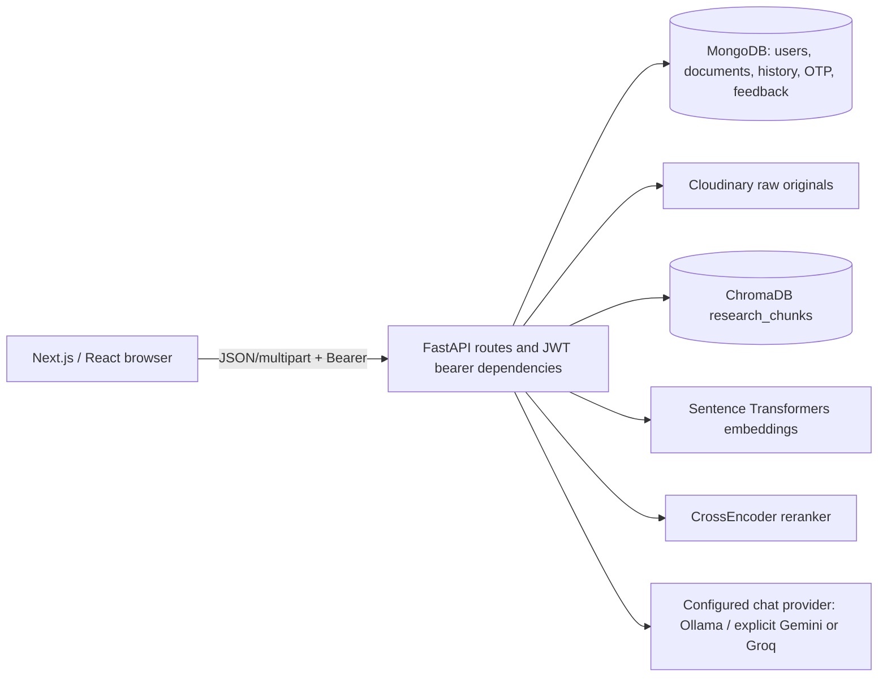
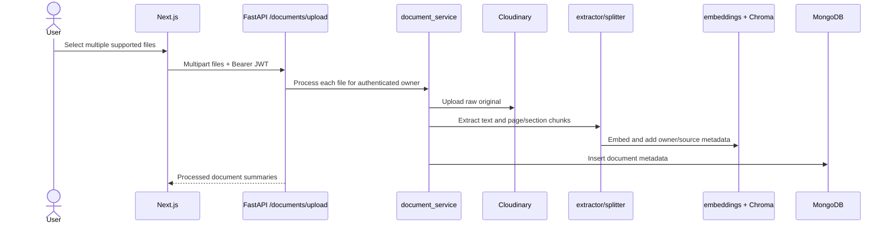
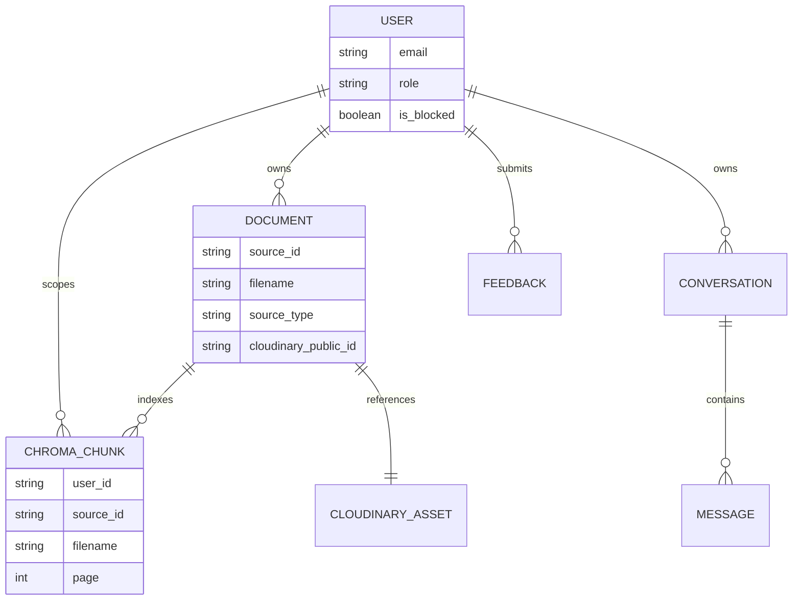

a# ResearchAI Project Audit

**Audit date:** 16 October 2026
**Repository:** `Multi-Document-Research-Assistant-New`
**Purpose:** Evidence-based repository reference for the WORKSBOT APPLICATIONS PRIVATE LIMITED internship assignment described in the supplied assignment text (email dated 19 August 2026).

## 1. Executive Summary

ResearchAI is a Next.js App Router frontend backed by FastAPI. It accepts user-owned files and web pages, extracts and chunks text, stores vectors in a local persistent ChromaDB collection, stores metadata/conversations in MongoDB, and stores uploaded originals in Cloudinary. Authenticated chat calls an Ollama/Gemini/Groq provider factory, retrieves user-scoped chunks through semantic and BM25-style lexical search, reranks candidates with a Sentence Transformers CrossEncoder, constructs bounded context, invokes an LLM, and returns citations. The checked local configuration selects Ollama with `llama3.2:latest`; the audit does not disclose any secret values.

Code and automated tests provide evidence for the assignment's ten functional areas. The strongest test evidence is for source restrictions, retrieval behavior, API ownership boundaries, provider selection through mocks, history/follow-up logic, and URL validation. Automated tests do not prove answer factuality, the accuracy of every citation, live Cloudinary access, or full end-to-end behavior for an actual user request. A production build passes. Frontend lint currently fails with four errors and reports five warnings.

The checked-out working tree contained numerous pre-existing modifications, deletions, and untracked files before this audit. They were preserved. The only file created for this task is this report. A significant repository hygiene finding is that the root `.gitignore` contains literal PowerShell here-string/Out-File commands rather than ignore patterns; backend and frontend local ignore files separately ignore their respective env files. No secret values were read into this report.

## 2. Official Internship Assignment and Acceptance Criteria

The supplied assignment is treated as the authoritative scope: a multi-document research platform supporting multiple PDFs, websites and other documents; retrieval, comparison, summarization, cited answers; hybrid search, reranking, and conversation memory. The assignment text says the deadline will be communicated at the end of the sessions. The statuses below describe repository evidence, not a claim of internship acceptance or production readiness.

| Official requirement | Evidence/status | Verification and limits |
|---|---|---|
| Multiple PDF ingestion | **Implemented** — multi-file upload route calls `process_uploaded_document`; PDF extraction uses `pypdf`. | Tests cover processing-related boundaries through mocks; no new live Cloudinary upload was performed. |
| Website ingestion | **Implemented** — `/urls/add` fetches public HTTP(S), extracts readable HTML, chunks it, stores vectors and Mongo metadata. | URL security tests pass; live arbitrary sites are subject to redirects, bot protection, dynamic rendering and network availability. |
| Multiple document formats | **Implemented** — PDF, DOCX, TXT, CSV, XLSX and PPTX are accepted/extracted. | No OCR path for image-only/scanned PDFs. Tests do not establish successful extraction for every real-world file. |
| Relevant information retrieval | **Implemented** — user-scoped semantic and lexical candidate retrieval and scoring. | Unit tests cover retrieval behaviors, not relevance quality across a benchmark corpus. |
| Cross-source/document comparison | **Partially Implemented** — query intent/source detection, per-source retrieval, comparison context selection and comparison-aware prompt exist. | Logic tests cover selected comparison/retrieval cases; no broad evaluation of correctness across actual source pairs. |
| Findings summarization | **Partially Implemented** — answer chain can summarize retrieved source context and prompt behavior adapts to query complexity. | No separate, independently evaluated synthesis/summarization workflow or quality benchmark was found. |
| Answers with accurate citations | **Partially Implemented** — citations are generated from retrieved metadata and returned with answer. | Evidence links are code-generated; exact factual support/accuracy is not guaranteed or comprehensively evaluated. |
| Hybrid semantic + keyword search | **Implemented** — Chroma semantic search merged with an independent BM25-style lexical pass. | Tests prove lexical-only hits and source filter behavior under controlled inputs; not a corpus-wide quality measure. |
| Reranking | **Implemented** — cached CrossEncoder candidate scoring and final ranking logic. | Model initialization tests are mocked; runtime/model availability depends on configured model/cache. |
| Conversation memory | **Implemented** — chat messages/conversations persist in MongoDB; recent turns are loaded and bounded history is passed to retrieval/prompt logic. | Follow-up behavior tests pass; no long-running production/session reliability test was performed. |

“Implemented” means code and corresponding local automated evidence exist; it does not mean live services and all data have been independently verified. Supporting capabilities such as authentication, ownership checks, file management and admin functions are described below, but are not extra official criteria.

## 3. Project Scope and Technology Stack

- **Frontend:** Next.js 16.3.5, React 19.2.8, JavaScript, App Router, Tailwind CSS 4, Lucide React. Configuration is in `frontend/package.json`, `frontend/next.config.mjs`, `frontend/postcss.config.mjs`, and `frontend/eslint.config.mjs`.
- **Backend:** Python FastAPI, Pydantic request models, Uvicorn entry point (`backend/app/main.py`). Runtime configuration uses dotenv/environment variables.
- **Persistence:** MongoDB via PyMongo; ChromaDB persistent local collection `research_chunks`; Cloudinary raw uploads for originals.
- **AI:** Sentence Transformers for embeddings and CrossEncoder reranking; LangChain chat model adapters; current local configuration selects Ollama (`llama3.2:latest`). The factory also contains explicit Gemini and Groq branches.
- **Document/web tools:** pypdf, python-docx, pandas, openpyxl, python-pptx, requests, BeautifulSoup, DDGS.
- **Authentication:** JWT bearer tokens, bcrypt/passlib password hashing, OTP/email, Google OAuth flow and roles.

Backend startup binds according to the launch command/environment; the checked project configuration does not establish a universal deployment port. The user's recent runtime evidence named port 8001; a live request was not conducted as part of this audit. The default frontend API base is `http://127.0.0.1:8001`, overridable by `NEXT_PUBLIC_API_BASE_URL`.

## 4. Complete Repository Structure and File Inventory

Generated/vendor directories are present but were not recursively dumped: root `venv/`, `frontend/node_modules/`, `frontend/.next/`, and `backend/chroma_data/`. They contain an environment, installed frontend dependencies/build output, and persistent vectors respectively, and are not source modules. `backend/.env` exists locally; its values are not included here.

```text
.
├── .gitignore                         # currently malformed; see §20
├── README.md                          # project overview; some claims conflict with code
├── requirements-new.txt               # additional/root Python dependency manifest
├── backend/
│   ├── .env.example, .gitignore, requirements.txt
│   ├── app/
│   │   ├── auth/{google_oauth,jwt,otp,password}.py
│   │   ├── core/model_cache.py
│   │   ├── database/mongodb.py
│   │   ├── documents/{document_service,extractor,loader,splitter}.py
│   │   ├── embeddings/embedding_model.py
│   │   ├── llm/llm_model.py
│   │   ├── models/{document,history,otp,url,user}.py
│   │   ├── rag/{chain,model_runtime,rag_service,retriever,vector_store}.py
│   │   ├── routes/{admin,auth,chat,documents,feedback,history,urls,users}.py
│   │   ├── schemas/{admin,auth,chat,document,feedback,history,url,user}.py
│   │   ├── services/{email_service,user_service}.py
│   │   └── urls/{extractor,loader,security,url_service}.py
│   └── tests/ (11 unittest modules)
└── frontend/
    ├── package.json, package-lock.json, Next/Tailwind/ESLint config
    ├── public/ (framework SVG assets)
    └── src/
        ├── app/ (home, auth, dashboard, documents, chat, history, viewer, admin)
        ├── components/ (shells, upload, chat, citation, feedback, document UI)
        └── lib/{api,auth,citations,documentFormats,viewerNavigation}.js
```

The full source list is captured in the paths and module catalogue in §8 and §25. Relevant Markdown also includes `frontend/README.md`. There are no checked-in Docker, CI workflow, or deployment manifests evident in the inspected source inventory. The root `README.md` is untracked in the initial Git status, as is the frontend tree; this report does not infer that they were committed or part of an earlier baseline.

## 5. Frontend Architecture and Feature Catalogue

The app uses Next.js App Router pages under `frontend/src/app`. There is no `middleware.js/ts` route guard found in the source inventory. Authentication is implemented client-side with `frontend/src/lib/auth.js` and shared requests in `frontend/src/lib/api.js`: token key `access_token` in `localStorage`; API calls add a bearer header; common API handling clears expired sessions and redirects from protected pages. This is not an HttpOnly-cookie session.

| Page/feature | Actual path and behavior | Main request/event path |
|---|---|---|
| Landing | `/` — `app/page.js` | Navigation links into register/login/workspace. |
| Login/register/OTP/reset | `/login`, `/register`, `/register/verify`, `/forgot-password` | Auth forms call shared API methods; OTP and password flows map to `/auth/*`. Google UI uses `GoogleAuthButton.js` and callback/set-password pages. |
| Dashboard | `/dashboard` | Loads `/users/me`, `/documents/`, `/history/conversations`; navigation to workspace. |
| Documents | `/documents` | Upload via `/documents/upload`, list `/documents/`, remove `/documents/{id}`, URL add/search/list via `/urls/*`; `DocumentCard` opens own files at `/viewer/{id}` and URL sources externally. |
| Chat | `/chat` | `handleSubmit` in `app/chat/page.js` guards duplicate submits, optionally uploads attachments, posts JSON to `/chat/`, handles a five-minute AbortController timeout, elapsed display and retry/error message. Results render `ChatMessage` and `CitationCard`. |
| History | `/history` | Lists/opens/deletes conversations using `/history/conversations*`. |
| Viewer | `/viewer/[documentId]` | `getDocumentFile` calls authenticated `/documents/view/{id}`; preview formats use `/documents/preview/{id}`. PDF bytes are checked for `%PDF-`; errors become visible UI messages. |
| Admin | `/admin`, `/admin/users`, `/admin/users/[userId]`, `/admin/documents`, `/admin/urls`, `/admin/feedback` | Shared bearer API requests to `/admin/*`; admin layout and UI components. |
| Feedback | dialog in shared shell/components | POST `/feedback/`; admin inbox reads/marks feedback via `/admin/feedback*`. |

`api.js` defaults the backend base to `127.0.0.1:8001`; `frontend/next.config.mjs` has no rewrite/proxy configuration. Browser calls are direct cross-origin fetches, so backend CORS must allow the frontend origin. The UI contains loading/empty/error states in major flows. Chat provides a stage and elapsed seconds but is non-streaming; stopping the browser wait does not prove the backend computation was cancelled. App pages and global/component styles are in `app/globals.css` and `app/styles/*.css`.

## 6. Backend Architecture and Feature Catalogue

`backend/app/main.py` creates FastAPI, configures CORS, includes routers, checks LLM configuration at startup, optionally warms embedding and reranker models, and initializes database indexes. `auth/jwt.py` implements bearer JWT verification, user lookup and admin role check. Routes delegate to services rather than holding all processing logic.

- **Auth/account:** `routes/auth.py`, `auth/{password,otp,google_oauth}.py`, `services/{user_service,email_service}.py`. Registration/OTP/login/password setup and Google OAuth are represented. SMTP/OAuth operation depends on environment credentials and callback setup.
- **Files:** `routes/documents.py` validates session, scopes document lookups to the current owner, delegates ingestion/list/deletion, and streams Cloudinary-backed files. PDF open endpoint is separate from XLSX preview JSON.
- **URL ingestion:** `urls/security.py` validates URL schemes, credentials, ports and resolved public IPs; `url_service.py` fetches with redirects disabled, strips non-content DOM elements, splits, embeds, stores source and offers DDGS text search. Dynamic JavaScript pages are not rendered.
- **RAG:** `routes/chat.py` validates attachment ownership, creates/loads conversation, retrieves recent user messages, persists user/assistant turns and invokes `rag_service.answer_question`. It logs total elapsed time and errors without intentionally logging prompts in that route.
- **Administration/feedback/history:** dedicated route modules perform role checks and user-scoped conversation operations. Feedback has a read/unread state; no resolution/comment workflow appears in its schema/route.
- **Errors:** routes generally convert service exceptions to HTTP errors; some responses include exception detail, so upstream error text should be reviewed before treating all errors as safe for production disclosure. Mongo initialization catches and prints a warning while application can proceed.

## 7. API Endpoint Catalogue

All paths are full FastAPI paths (router prefixes are included in `main.py`). Protected means `get_current_user`; admin means `get_current_admin` or equivalent admin dependency. Request and response detail is summarized strictly to fields visibly consumed/returned; exact OpenAPI contracts should be generated from the running version before external publication.

| Method/path | Purpose; request/response outline | Access; implementation/frontend |
|---|---|---|
| `GET /` | API-running message | Public; `main.py`. |
| `GET /health` | Health status incl. Mongo connectivity indicator | Public; `main.py`. |
| `POST /auth/register` | Registration fields; result initiates verification flow | Public; `auth.py`, register page. |
| `POST /auth/verify-otp` | email/OTP verification | Public; verify page. |
| `POST /auth/resend-otp` | resend verification code | Public; auth pages. |
| `POST /auth/login` | credentials; returns token/user session fields | Public; login page. |
| `GET /auth/google` | starts Google OAuth/signup intent | Public; Google button. |
| `GET /auth/google/callback` | OAuth callback/state exchange and frontend redirect | Public callback; auth module. |
| `POST /auth/google/password/setup` | one-time Google signup password setup | Public one-time code; callback flow. |
| `POST /auth/password/setup/request` | password setup/reset OTP request | Public; forgot-password UI. |
| `POST /auth/password/setup/confirm` | verifies code and sets password | Public; forgot-password UI. |
| `GET /users/me` | current user profile | Protected; dashboard/admin UI. |
| `POST /documents/upload` | multipart `files`; returns processed document summaries | Protected; documents page/chat attachment upload. |
| `GET /documents/` | owner’s file and URL source metadata | Protected; documents/dashboard. |
| `GET /documents/view/{document_id}` | streams actual owner PDF from Cloudinary | Protected, owner-scoped; viewer/citation file open. |
| `GET /documents/preview/{document_id}` | structured XLSX preview rows | Protected, owner-scoped; viewer. |
| `DELETE /documents/{document_id}` | deletes owner document/storage/vectors | Protected, owner-scoped; documents page. |
| `POST /urls/add` | JSON URL; returns source metadata after ingestion | Protected; documents page. |
| `GET /urls/search?query=...` | DDGS result list (up to five) | Protected; documents page. |
| `GET /urls/` | list current user's URL sources | Protected; documents page. |
| `POST /chat/` | `question`, optional `conversation_id`, up to 10 `attachment_document_ids`; returns answer, citations, conversation id and attachments | Protected, owner-scoped; chat page. |
| `GET /history/conversations` | user conversation summaries | Protected; dashboard/history. |
| `GET /history/conversations/{conversation_id}` | conversation messages/citations | Protected and owner-scoped; history/chat. |
| `DELETE /history/conversations/{conversation_id}` | deletes own conversation and associated messages | Protected and owner-scoped; history. |
| `GET /admin/overview` | admin aggregate/dashboard | Admin; admin pages. |
| `GET /admin/users` | paginated/listed user information | Admin; admin users. |
| `GET /admin/users/{user_id}` | user details and related data | Admin; user detail. |
| `PATCH /admin/users/{user_id}/block` | block a user | Admin; admin users. |
| `PATCH /admin/users/{user_id}/unblock` | unblock a user | Admin; admin users. |
| `GET /admin/documents` | administrative document inventory | Admin; admin documents. |
| `GET /admin/urls` | administrative URL inventory | Admin; admin URLs. |
| `POST /feedback/` | category/message; returns feedback id | Protected; FeedbackDialog. |
| `GET /admin/feedback` | feedback list, optional unread filter/limit | Admin; admin feedback. |
| `GET /admin/feedback/notifications` | unread count and recent unread items | Admin; admin shell. |
| `PATCH /admin/feedback/{feedback_id}/read` | marks feedback read | Admin; feedback UI. |

No endpoint for browser-direct Gemini/Ollama access exists; LLM use is backend-only. No API proxy rewrite exists in Next configuration.

## 8. Functions, Classes, Imports, and Module Relationships

Selected high-value function catalogue (line numbers refer to the inspected checkout; lines can move as local edits evolve):

| Module | Important entry points and relationship |
|---|---|
| `backend/app/main.py` | `configured_frontend_origins` (61), `lifespan` (87), OpenAPI setup, `/` and `/health` (257, 267). Imports routers, LLM warning and model warmup. |
| `auth/jwt.py` | `create_access_token` (17), `decode_access_token`, `get_current_user` (75), `get_current_admin` (134). HTTPBearer → JWT validation → Mongo user and blocked/account role checks. |
| `routes/auth.py` | Google start/callback, registration, verify/resend OTP, password setup, login. Uses user/password/OTP/OAuth/email services and returns app JWT for successful sign-in. |
| `routes/chat.py` | `chat` (27). Validates attachments/conversation ownership, reads recent history, writes messages, invokes `answer_question`, returns answer/citations. |
| `rag/rag_service.py` | `answer_question` (1162), `build_context` (26), `create_citations` (145), `filter_displayed_sources` (338), history and follow-up analyzers. Orchestrates retriever and generation chain. |
| `rag/retriever.py` | `get_reranker` (234), token/keyword/BM25 (263–375), source detection/filtering, `build_candidates` (1617), `rerank_candidates` (1696), `hybrid_retrieve` (2494), public retrieval wrappers (2972 onward). Uses Mongo document metadata, Chroma functions and CrossEncoder. |
| `rag/chain.py` | `fit_generation_context` (1039), `get_answer_chain` (1386), `generate_answer` (2013), history/context selection helpers. Builds prompt and invokes cached selected provider. |
| `rag/vector_store.py` | `get_chroma_client`/collection (32/43), `add_chunks` (55), semantic search (101), user chunks (178), delete source (239), source-constrained search (302). Calls embedding helper and Chroma. |
| `documents/document_service.py` | `classify_document` (355), `process_uploaded_document` (649), list (1011), delete (1077). Uploads Cloudinary original, extracts/splits/indexes, writes Mongo metadata, compensates cleanup on ingestion failure. |
| `documents/extractor.py` | `extract_pdf`, `extract_docx`, `extract_txt`, `extract_csv`, `extract_excel`, `extract_pptx`. Dispatch selected by file extension from document service. |
| `documents/splitter.py` | section heading/parent/cleaning helpers and `split_document_pages` (124), `split_text` (336); produces page/section aware chunks. |
| `embeddings/embedding_model.py` | synchronized cached `get_embedding_model`; `create_embeddings` normalizes encoded vectors. |
| `rag/model_runtime.py` | `warmup_rag_models`, warmup status getter; initializes embedding and reranker at startup when enabled. |
| `llm/llm_model.py` | provider configuration/validation and cached `get_llm` (231); selects Ollama, Gemini or Groq from env. Imports adapters. |
| `core/model_cache.py` | synchronized LRU wrapper to prevent duplicate concurrent initialization on cache misses. |
| `database/mongodb.py` | `MongoClient`, collections and `initialize_database` indexes. Database is shared by auth/docs/history/feedback services. |
| `urls/security.py` | `validate_public_http_url` blocks non-HTTP(S), credentials, nonstandard ports and non-public DNS addresses. |
| `urls/url_service.py` | `fetch_url_content`, `add_url_source`, `list_user_urls`, `search_web`; uses requests/BS4/DDGS, splitter, Chroma, Mongo. |
| Frontend `lib/auth.js`, `lib/api.js` | token save/get/clear and shared bearer API/file handling; pages should use these instead of constructing independent credentials. |
| Frontend `app/chat/page.js` | submit/stop/new chat/attachment handlers and response rendering; requests `/chat/` and `/documents/upload`. |
| Frontend `app/viewer/[documentId]/page.js` | loads the file/preview helpers and renders loading, error, PDF or tabular view. |

`backend/app/models/*.py` contains domain data helpers/shapes; actual durable database records are Mongo documents rather than a relational ORM. `backend/app/schemas/*.py` defines Pydantic route inputs/outputs where used. Python imports are intra-package under `app.*`; frontend uses `@/` alias configured in `jsconfig.json`.

## 9. LLM, Embeddings, and RAG Architecture

The chat lifecycle is `POST /chat/` → bearer/user verification → attachment id ownership lookup → user conversation/history lookup → persist user question → `answer_question` → retrieve/merge/rerank → bounded prompt/context → `generate_answer` → `get_llm` → persist answer/citations → JSON response. Chat input validation permits a non-empty question and at most ten attached document IDs.

- Provider selection uses `LLM_PROVIDER`; default in code is Ollama. Checked local runtime settings selected `ollama`, model `llama3.2:latest`, base URL loopback port 11434, timeout 180 seconds, keep-alive `30m`. These are environment/runtime facts observed in the local project, not portable defaults for all installations. Gemini and Groq are explicit alternatives requiring their own keys; no key values appear here.
- Embedding model name is read from `EMBEDDING_MODEL`; the environment template names provider-independent settings but does not provide a value. The checked local env selected `sentence-transformers/all-MiniLM-L6-v2`. Embeddings use normalization and NumPy output. Vector dimension was not separately established in this audit.
- Reranker reads `RERANKER_MODEL`, default `cross-encoder/ms-marco-MiniLM-L6-v2`; `get_reranker` caches instance and logs initialization/prediction timing.
- `model_cache.synchronized_lru_cache` and embedding/reranker/LLM factories reuse initialized objects. `model_runtime` may warm embedding and reranker during startup. The environment template includes warmup and Hugging Face download timeout names.
- Context fitting in `chain.py` estimates up to 12,000 request tokens and caps formatted conversation history at 2,500 characters. These are application estimates/limits, not necessarily an LLM tokenizer's exact count.
- LLM calls are synchronous and non-streaming. Chat route logs elapsed total, but fine-grained retrieval and generation timing exists in some paths rather than a unified trace for every request. Client waits five minutes; Ollama factory timeout defaults to 180 seconds. Actual completion can still be slow due to cold model loading, local CPU/GPU, large user corpus or external service state.
- Source restrictions are implemented as retrieval allowlists/source-aware retrieval and tests cover an explicitly named missing PDF returning no evidence. Attachments are owner-validated before retrieval. General-knowledge fallback is gated, and named-source boundary tests assert that unrelated resume context is excluded.

## 10. Document Ingestion and Processing

`POST /documents/upload` accepts multiple multipart files. Supported extensions are PDF, DOCX, TXT, CSV, XLSX, and PPTX. The service creates a source ID, uploads original bytes to Cloudinary as `resource_type="raw"` in folder `multi-document-research`, uses returned public ID/secure URL metadata, writes a temporary local file for extractor dispatch, classifies content, splits chunks, adds user/source metadata and vectors, and inserts document metadata into MongoDB. Error paths attempt to remove partial vector/Cloudinary artifacts; cleanup tests check source scoping.

Chunking is based on LangChain `RecursiveCharacterTextSplitter` with 1,000-character chunks and 150 overlap, plus page and section hierarchy metadata. PDF pages are extracted with pypdf; DOCX paragraphs with python-docx; TXT with UTF-8; CSV/XLSX with pandas; PPTX slides with python-pptx. Scanned/image PDFs have no OCR stage. Spreadsheet extraction can flatten table-like values; exact semantic preservation of workbook formatting/formulas is not claimed. Ingestion requires available embedding model, Chroma, Mongo, Cloudinary and supported/parseable content.

Website ingestion follows a separate path (§16): it does not upload website HTML to Cloudinary. It stores URL and title/text-derived chunks in Chroma and a Mongo document-like source record.

## 11. Semantic Search, Keyword Search, Hybrid Retrieval, and Reranking

Chroma collection `research_chunks` persists embeddings and chunk text/metadata under `CHROMA_PATH` (default local `./chroma_data`). Per-query semantic search filters by user metadata and can scope by allowed source IDs. The retriever also retrieves user chunks for an independent tokenized lexical/BM25-style score; merges semantic and lexical candidates, deduplicates, applies source/intent filters, selects candidates with source diversity and reranks with a CrossEncoder. Final scoring combines semantic, lexical, rerank, and other relevance signals and applies threshold/source grouping logic.

Tests in `test_rag_context.py` demonstrate that BM25 can retrieve exact terms missed by semantic search, respects explicit source filters, and returns a lexical hit if semantic search is empty. Other tests check candidate coverage, rerank selection and per-source diversity. Those tests use controlled data and do not measure ranking quality against labeled ground truth. Lexical search currently scans/indexes user corpus chunks, so its work can grow with stored corpus size; Chroma is local-file persistence, not a distributed vector service.

## 12. Cross-Document Comparison and Summarization

Retriever detects comparison language, named sources, source types and resume intent. Candidate grouping/diversity and chain context selection aim to include evidence from each selected source. Prompt instructions support comparison/synthesis and avoid using prior conversation as factual evidence. For explicit named file requests, the code establishes source allowlists; tests cover `llm.pdf`-style restriction behavior and missing-source no-evidence handling.

These are implemented mechanics rather than proof that every generated comparison is correct. There is no separately verified comparison benchmark or structured comparison endpoint. Summarization is performed as an LLM answer to a summary question over retrieved sources, not as an offline per-document summary feature. Real provider output varies with model version and context quality.

## 13. Citations, Source Restrictions, and Conversation Memory

Citation assembly in `rag_service.create_citations` groups retrieved evidence by document/source and uses metadata such as filename, page and section; response filtering controls which source cards are displayed. Frontend `CitationCard` renders source links/page references. Page values depend on extractor metadata; website sources use page 0. The application does not independently verify each textual claim against its cited chunk after generation.

Explicit source selection uses named-source resolution and source ID allowlisting before semantic/lexical retrieval. Attachment IDs are verified against Mongo ownership in `routes/chat.py`. The tests include unrelated-source exclusion, missing named source no-evidence, attached-source allowlisting, and retrieval/display behavior. Conversation history loads at most 20 prior messages in chat route; chain truncates history to 2,500 characters and uses it mainly to resolve follow-up references, not as factual evidence. Conversations/messages persist in MongoDB and endpoints scope by user ID.

## 14. Database, Vector Store, and File Storage

- **MongoDB:** URI is read from `MONGODB_URI`, database name from `DATABASE_NAME`; collections are users, OTP, documents, conversations, messages, Google OAuth states and feedback. `initialize_database` creates unique email/state indexes, TTL expiry indexes for OTP/state, user/document/conversation/message indexes and feedback date/read indexes. Connection settings include 10-second server selection/connect/socket timeouts. Startup catches database setup failure and prints a warning rather than forcibly stopping in this code path.
- **ChromaDB:** local persistent client/collection from `CHROMA_PATH`/default `./chroma_data`; collection name `research_chunks`. Chunk metadata includes at least user ID, source ID/type, filename/file type/page and section hierarchy. User-scope filters are part of retrieval. Deletion calls source-scoped vector delete.
- **Cloudinary:** originals uploaded as raw assets, with public ID, secure URL, file metadata and owner/document linkage stored in Mongo. View route first finds only owner-owned file record, builds a private download URL from stored reference, fetches upstream with timeout/redirect restrictions, streams PDF bytes with inline headers and size bound. This code path plus mocked route tests was verified; no actual live asset was fetched during this audit.
- Deletion cleans vectors, Cloudinary raw asset and Mongo record through service logic; cleanup tests verify source scoping and compensation behavior with mocked components. There is no cross-provider distributed transaction; failure recovery is best effort, not an atomic database transaction.

## 15. Dependency and Configuration Audit

`backend/requirements.txt` and root `requirements-new.txt` are pinned Python manifests. They declare major runtime libraries including FastAPI/Uvicorn, PyMongo, ChromaDB, Cloudinary, LangChain provider adapters, Sentence Transformers/Torch, pypdf, Office/spreadsheet readers, requests/BS4, DDGS, dotenv and JWT/password packages. Both manifests appear broad and include transitive/support packages as direct requirements. The backend requirements file was already modified in the initial working tree; no dependency operation was performed. Frontend package lock is npm lockfile v3; `package.json` declares Next/React/Lucide and Tailwind/ESLint toolchain.

Actual code imports Gemini, Groq and Ollama adapters from `llm_model.py`; factory selects by configuration, so all adapters are not necessarily used in a run. No `ChatGroq` use outside the provider factory was identified. Import/manifest parity was not exhaustively machine-checked for every transitive dependency. Do not remove dependencies based solely on this audit.

Environment **names** observed include `MONGODB_URI`, `DATABASE_NAME`, `JWT_SECRET_KEY`, `JWT_ALGORITHM`, `JWT_EXPIRE_MINUTES`, `FRONTEND_ORIGIN`, `NEXT_PUBLIC_API_BASE_URL`, `CLOUDINARY_CLOUD_NAME`, `CLOUDINARY_API_KEY`, `CLOUDINARY_API_SECRET`, `LLM_PROVIDER`, `GEMINI_API_KEY`, `GROQ_API_KEY`, `OLLAMA_BASE_URL`, `OLLAMA_MODEL`, `OLLAMA_REQUEST_TIMEOUT_SECONDS`, `OLLAMA_KEEP_ALIVE`, `EMBEDDING_MODEL`, `RERANKER_MODEL`, `RAG_MODEL_WARMUP_ON_STARTUP`, `HF_HUB_ETAG_TIMEOUT`, and `HF_HUB_DOWNLOAD_TIMEOUT`, plus email/Google OAuth settings. Names are not secrets; values are omitted. Backend and frontend local `.gitignore` files ignore their environment files, and `git check-ignore` confirmed `backend/.env` and `frontend/.env.local` are ignored. The malformed root `.gitignore` does not reliably ignore root-level paths.

`frontend/next.config.mjs` has no proxy/rewrites. `.env.example` files are templates; runtime availability is not guaranteed from their presence. Local Ollama service/model availability was confirmed in the earlier runtime evidence captured for this audit: Ollama tags/process showed `llama3.2:latest` installed/running. That does not constitute a real authenticated chat completion in this audit.

## 16. End-to-End Application Workflows

1. **Login:** frontend submits credentials to `/auth/login`; backend verifies password/account status and issues JWT; frontend shared helper saves `access_token`; shared API adds `Authorization: Bearer` to protected calls.
2. **File ingestion:** multi-file form → `/documents/upload` → authenticated route → Cloudinary raw original → temporary extraction → classification/chunking/embedding → user-scoped Chroma → Mongo metadata; errors attempt cleanup.
3. **Website ingestion:** public URL → DNS/public-address validation → GET with redirect disabled and 15-second timeout → BeautifulSoup text cleanup → split/embed → Chroma and Mongo source record.
4. **Question:** Ask AI submit → optional attachment upload → `/chat/` bearer request → validate attachment/conversation owner → retrieve recent turns → persist user prompt → RAG query analysis/retrieval → hybrid merge/rerank → context fit/prompt → selected LLM → citations/history persist → frontend displays answer and citation cards.
5. **Follow-up:** chat sends existing conversation ID; backend verifies user owns it, loads up to 20 messages, passes bounded history to reference resolution and chain.
6. **Open/view:** DocumentCard routes to same-origin viewer with Mongo ID; viewer uses shared API helper and Bearer JWT on `/documents/view/{id}`; backend re-checks ownership, fetches private Cloudinary bytes and streams as PDF. XLSX uses separate preview endpoint.
7. **Delete:** owner-scoped DELETE route/service removes source vectors, remote raw asset and Mongo record; error cleanup is best-effort.

## 17. Mermaid Architecture Diagrams

### System architecture



### Document ingestion



### Question answering

```mermaid
sequenceDiagram
  actor U as User
  participant F as Chat page
  participant R as POST /chat/
  participant DB as MongoDB
  participant G as rag_service / retriever
  participant V as Chroma + BM25
  participant X as CrossEncoder
  participant L as chain / configured LLM
  U->>F: Ask a question
  F->>R: Question, optional conversation and attachment IDs
  R->>DB: Verify ownership; read history; store user turn
  R->>G: answer_question(user, query, history, attachments)
  G->>V: User/source scoped semantic and lexical retrieval
  V-->>G: Merged candidates
  G->>X: Rerank selected candidates
  X-->>G: Ranked evidence
  G->>L: Bounded context and prompt
  L-->>G: Answer
  G-->>R: Answer and metadata-derived citations
  R->>DB: Store assistant turn
  R-->>F: JSON response
```

### Persistence relationships



The diagram represents logical references observed in code; MongoDB does not enforce foreign keys, and Cloudinary/Chroma are external/local stores.

## 18. Internship Requirements Traceability Matrix

| Requirement | Evidence: file, function/endpoint | Status | Verification | Limitations | Required next step |
|---|---|---|---|---|---|
| Multiple PDFs | `backend/app/routes/documents.py:upload_documents`; `backend/app/documents/document_service.py:process_uploaded_document`; `POST /documents/upload`; `extract_pdf` | Implemented | Backend suite passes; service/route tests use mocks | No live multi-PDF upload was performed. | Demonstrate multi-PDF upload and inspect extracted text/citations. |
| Website ingestion | `backend/app/routes/urls.py:add_url`; `backend/app/urls/security.py:validate_public_http_url`; `url_service.fetch_url_content` / `add_url_source`; `POST /urls/add` | Implemented | URL security tests: 3 passed; code inspected | Dynamic/blocked pages and external site availability remain limitations. | Try representative public URLs and record successful/blocked cases. |
| Multiple formats | `backend/app/documents/document_service.py:ALLOWED_EXTENSIONS`; `backend/app/documents/extractor.py` PDF/DOCX/TXT/CSV/XLSX/PPTX extractors | Implemented | Code inspection; viewer/API tests | No real fixture validation for every format; no OCR. | Verify representative real files per supported extension. |
| Relevant retrieval | `backend/app/rag/retriever.py:hybrid_retrieve`, `bm25_candidates`; `backend/app/rag/vector_store.py:search_semantic` | Implemented | Retrieval tests pass | No labeled relevance corpus/metric. | Evaluate recall/ranking against a small reviewed query set. |
| Cross-source comparison | `backend/app/rag/retriever.py` source/query detection; `backend/app/rag/chain.py` comparison context selection; `answer_question` / `generate_answer`; `POST /chat/` | Partially Implemented | Mock/unit tests cover source discovery/retrieval patterns | Real multi-source comparison accuracy not measured. | Run and manually assess comparison questions over two real sources. |
| Summarization | `backend/app/rag/chain.py` answer prompt/context; `POST /chat/` | Partially Implemented | No independent summary benchmark found | No separate evaluated document-summary workflow. | Define sample corpus and expected summary evidence/quality. |
| Accurate cited answers | `backend/app/rag/rag_service.py:create_citations`; `POST /chat/`; frontend `CitationCard` | Partially Implemented | Tests check citation grouping and response serialization | Claim-to-source correctness is not automatically verified. | Manually review a representative set of answer claims and citations. |
| Hybrid search | `backend/app/rag/retriever.py:bm25_candidates`, `merge_retrieval_candidates`, `hybrid_retrieve` | Implemented | BM25 semantic-miss/source-filter tests pass | No benchmark for retrieval quality/latency. | Benchmark hybrid results on project documents. |
| Reranking | `backend/app/rag/retriever.py:get_reranker`, `select_rerank_candidates`, `rerank_candidates` | Implemented | Caching and retrieval tests; no ranking-quality benchmark | Runtime model availability depends on host/cache. | Record cold/warm model startup and assess ranked candidates. |
| Conversation memory | `backend/app/routes/chat.py:chat`; `backend/app/routes/history.py`; follow-up helpers in `rag_service.py` | Implemented | Follow-up tests pass | Live multi-turn workflow not exercised in browser. | Demonstrate follow-up and history reload with an authenticated session. |

## 19. Tests and Verification Results

Checks were run without editing application source/dependencies or intentionally altering persistent user data:

| Command | Result | Type and caveat |
|---|---|---|
| From `backend/`, `$env:MONGODB_URI='mongodb://127.0.0.1:27017/research_test'; ..\venv\Scripts\python.exe -m unittest discover -s tests -v` | **Passed: 103 tests, 1.290s.** | Automated unit/route tests; integrations/models are mocked in relevant tests. Local test database URI was set only for this process; test suite printed “Database initialization complete.” No live Mongo, Cloudinary or Ollama chat completion is claimed from this result. |
| Initial diagnostic `python -m unittest ...` using system Python | **Failed at import (10 module errors; 3 URL security tests passed).** | Wrong interpreter lacked project dependencies (`cloudinary`, `bson`, `sentence_transformers`, `pymongo`, and httpx2 support). Correct virtualenv rerun above passed. |
| From `frontend/`, `node --test src/lib/api.test.mjs src/lib/documentFormats.test.mjs src/lib/viewerNavigation.test.mjs` | **Passed: 17 tests, 0 failures.** | Frontend helper/unit tests; Node emitted MODULE_TYPELESS_PACKAGE_JSON warnings for ESM helper files. |
| From `frontend/`, `npm.cmd run build` | **Passed.** | Next.js 16.3.5 optimized production build compiled and prerendered static pages; viewer/admin dynamic routes listed. Build success does not test live backend integration. |
| From `frontend/`, `npm.cmd run lint` | **Failed: 4 errors, 5 warnings.** | ESLint findings in documents page (2 setState-in-effect), history page (declaration access), verify page (setState-in-effect); warnings for internal `window.location.href` navigation in history/login/register/verify/api. |

No new test files were added: this was a documentation-only audit. Prior tests present in repository cover view ownership/auth, Cloudinary missing/upstream failure (mocked), provider selection (mocked), source restrictions, BM25, history/follow-up, model caching and URL validation. No authenticated browser session was available for live acceptance testing during this audit; no real Research Chat answer or live Cloudinary asset retrieval is claimed.

## 20. Security, Reliability, and Performance Findings

- JWT uses bearer authorization, expiration and database-backed current-user lookup; blocked accounts receive 403. Admin-only routes use role checks. Document and conversation lookups are owner-scoped in the inspected handlers.
- Password hashes use bcrypt/passlib. OTP and Google OAuth state have expiry/TTL indexes; state/code flow includes single-use/hashed references as exercised by tests.
- `localStorage` bearer tokens are exposed to same-origin JavaScript, so an XSS compromise can read them; no server-side HttpOnly cookie flow was found.
- URL ingestion performs public DNS/IP validation and refuses redirects. This limits common SSRF cases; the code performs DNS validation separately from the subsequent HTTP client DNS lookup, so DNS rebinding/time-of-check differences remain a hardening topic rather than a demonstrated exploit here.
- Cloudinary originals are raw assets; viewer route checks owner before retrieval and uses a private download URL. Tests mock Cloudinary and do not establish live credentials/asset availability.
- Local Chroma persistence requires durable storage and a single shared data path; horizontal multi-instance consistency is not established.
- Chat is synchronous/non-streaming; browser abort after five minutes may stop waiting while backend/model work can continue. Cached model initialization reduces repeated loading within one process, but the first startup may load/download substantial weights.
- Root `.gitignore` is malformed (literal command text), so root-level `.env`, `venv`, cache, uploads and Chroma paths are not reliably ignored by that file. Backend and frontend nested ignore files do ignore their local env files, as confirmed by `git check-ignore`. Fixing this is outside the requested audit-only scope; verify `git status` carefully before committing secrets/data.
- Some routes return error details derived from exception text. Review production-safe error shaping so secrets/upstream internals cannot be included by a dependency exception; this audit did not demonstrate secret leakage.

## 21. Known Bugs, Limitations, Missing Features, and Unverified Behaviour

1. **Frontend lint issues:** exact current failures/warnings are recorded in §19; build still passes.
2. **README drift:** root README contains architecture claims that do not match current code, including a Gemini-only diagram/active factory narrative and claims about runtime behaviors that appear stale. The current code defaults to Ollama; provider adapters are selectable. Treat implementation as source of truth.
3. **No OCR:** image-only/scanned PDF text extraction is not supported by the inspected extractor.
4. **Web scraping limitations:** requests + BeautifulSoup do not execute JavaScript; strict no-redirect policy requires users to submit final page URL; anti-bot pages may not yield text.
5. **Web search is discovery only:** `/urls/search` returns snippets/results; it does not automatically ingest each result. The page permits a separate add URL action.
6. **No LLM streaming:** browser sees a single completed JSON answer; elapsed status is not live generation progress.
7. **Citation correctness not proven:** metadata-based citations are returned, but no automatic claim-support verifier or broad manual evaluation was run.
8. **Live external services:** no fresh real Ollama answer, Mongo data validation, Cloudinary PDF retrieval, SMTP email, or Google OAuth round trip was performed by this audit. Previous runtime evidence confirmed local Ollama service/model presence only.
9. **Frontend lint error/warning state:** see `documents/page.js`, `history/page.js`, `register/verify/page.js`, `login/page.js` and `lib/api.js` referenced by lint output.
10. **No deployment manifest/CI evidence:** inspected inventory shows local application configs and lockfiles but no checked-in Docker/Kubernetes/CI workflow file.

## 22. Deployment and Environment Requirements

For local execution, the source indicates separate frontend and backend processes. Backend needs the pinned Python environment, valid MongoDB URI/database, JWT secret/algorithm, Cloudinary credentials, SMTP and Google OAuth settings if those features are used, plus model settings. Ollama must be reachable at configured URL and selected model installed; embeddings/reranker need local cache or network access for first load. Frontend needs Node/npm and `NEXT_PUBLIC_API_BASE_URL` if default loopback API address is not appropriate. Backend CORS `FRONTEND_ORIGIN` must match the browser origin. `CHROMA_PATH` should point to persistent writable storage.

Environment files must be created locally from templates and kept out of version control. This report intentionally lists variable names only. The exact production topology, HTTPS termination, secrets manager, backups and deployment procedure are not established by repository evidence and should be designed before production use.

## 23. Remaining Work Within the Existing Assignment Scope

- Resolve the four lint errors and five warnings, then rerun lint/build.
- Perform a browser demonstration that uploads multiple real files, ingests a public website, asks an explicit two-source comparison, follows up in the same conversation, and opens the cited files.
- Evaluate citation support and comparison/summarization quality with a small human-reviewed test set.
- Verify live Cloudinary private PDF retrieval and recovery behavior with a known owned test asset.
- Record repeatable retrieval/generation timings on target hardware and distinguish cold startup from warm requests.
- Replace/repair the root `.gitignore` contents after reviewing working-tree state; confirm ignore rules cover all local secrets, model/vector data, uploads and build artifacts.
- Align README and environment documentation with current provider selection and verified service setup.
- Decide whether OCR, streaming and scalable vector storage are needed for the actual internship demo; they are limitations, not explicit requirements in the supplied assignment.

No changes above were applied in this audit.

## 24. Glossary of Technical Terms

- **API:** HTTP interface exposed by the backend.
- **BM25:** lexical ranking method based on query-term frequency and document length.
- **Bearer JWT:** signed token sent in an `Authorization` header to identify an authenticated session.
- **ChromaDB:** vector store used here to persist embeddings and chunk metadata locally.
- **Chunk:** bounded text segment indexed for retrieval.
- **CrossEncoder/reranker:** model that scores query-text pairs to reorder retrieval candidates.
- **Embedding:** numeric vector representation of text used for semantic similarity search.
- **Hybrid retrieval:** combining semantic vector search with lexical matching.
- **LLM:** large language model used to synthesize an answer from the question and evidence.
- **MongoDB:** document database used for users, metadata, conversations and feedback.
- **RAG:** retrieval-augmented generation; retrieve evidence, then provide it as context to an LLM.
- **Source restriction:** allowlist limiting retrieval to named/attached documents or URLs.
- **SSRF:** server-side request forgery, in which an attacker attempts to make a server request internal resources.
- **TTL index:** MongoDB index that expires records after a configured time.

## 25. Evidence Index with File Paths, Function Names, and Line References

Line references reflect this inspected working tree and are intended as navigation aids.

| Topic | Primary evidence |
|---|---|
| App startup/CORS/routers/health | `backend/app/main.py` — `configured_frontend_origins` L61, `lifespan` L87, router includes L221–253, `/health` L267. |
| Authentication/JWT/roles | `backend/app/auth/jwt.py` — create/decode/current user/admin L17–140; `backend/app/routes/auth.py` — auth endpoints L76 onward and login L595; `backend/app/services/user_service.py`; `backend/app/auth/password.py`; `backend/app/auth/otp.py`; `backend/app/auth/google_oauth.py`. |
| DB collections/indexes | `backend/app/database/mongodb.py` L4–81; `backend/app/models/{user,document,history,otp}.py`. |
| Document endpoints/private file | `backend/app/routes/documents.py` — owner and Cloudinary helpers L39–103, upload L105, list L166, view L181, preview L235, delete L282. |
| Ingestion/classification/storage cleanup | `backend/app/documents/document_service.py` — supported types L32, classifier L355, upload/process L649, listing L1011, deletion L1077. |
| Extraction/chunking | `backend/app/documents/extractor.py` L9–143; `backend/app/documents/splitter.py` L23–336. |
| Embedding/cache/warmup | `backend/app/embeddings/embedding_model.py`; `backend/app/core/model_cache.py`; `backend/app/rag/model_runtime.py`. |
| LLM selection | `backend/app/llm/llm_model.py` — default constants L15–20, provider getters L109–145, validation L148–208, factory L231 onward. |
| Chat/history | `backend/app/routes/chat.py` — route L27 and persistence/invocation L34–210; schema `backend/app/schemas/chat.py`; `backend/app/routes/history.py`. |
| Retrieval/citations/prompt | `backend/app/rag/retriever.py` — BM25 L301, hybrid retrieval L2494; `backend/app/rag/rag_service.py` — citation construction L145, answer entry L1162; `backend/app/rag/chain.py` — context fitting L1039, answer chain L1386, generation L2013; `backend/app/rag/vector_store.py`. |
| URL security/ingestion | `backend/app/urls/security.py`; `backend/app/urls/url_service.py` — fetch L25, ingestion L103, search L259; `backend/app/routes/urls.py`. |
| Admin/feedback | `backend/app/routes/admin.py`; `backend/app/routes/feedback.py`; `backend/app/schemas/admin.py`, `feedback.py`. |
| Frontend session/API | `frontend/src/lib/auth.js`; `frontend/src/lib/api.js`; pages under `frontend/src/app/login`, `register`, `auth/google`, `forgot-password`. |
| Frontend product flows | `frontend/src/app/chat/page.js`; `documents/page.js`; `dashboard/page.js`; `history/page.js`; `viewer/[documentId]/page.js`; admin pages. |
| Shared UI/styles | `frontend/src/components/*.js`; `frontend/src/app/styles/*.css`; `frontend/src/app/globals.css`. |
| Dependencies/config | `backend/requirements.txt`, `requirements-new.txt`, `backend/.env.example`, `.gitignore` files; `frontend/package.json`, `package-lock.json`, `next.config.mjs`, `eslint.config.mjs`, `postcss.config.mjs`. |
| Tests | `backend/tests/test_*.py` (11 files); `frontend/src/lib/{api,documentFormats,viewerNavigation}.test.mjs`. |
| Documentation | root `README.md`, `frontend/README.md`; root README assertions should be reconciled with current code before using as implementation evidence. |

---

**Audit boundary:** Static inspection and the commands in §19 describe this checkout. Automated test/build success does not imply that all external credentials, production data, browser sessions, generated answers, or remote assets were verified.
